# Keelson — AI-powered supply-chain disruption planning & recovery

**Keelson** is a generic, agentic engine that **senses**, **investigates**, **plans** and **remediates** supply-chain disruptions. A disruption can arrive from **news & hazard feeds**, **events in connected systems**, a **supplier email**, or a planner's **chat question** ("a typhoon is heading for Ho Chi Minh City — what's our exposure?", "what if the Suez Canal closes for 3 weeks?").

It ships with **Merxa Retail Suite**, a deliberately separate *mock third-party ERP* (SKUs, POs, inventory, shipping, stores…). Keelson connects to it **only through MCP / REST / webhooks**. That separation lets the demo prove three things: the AI can produce a remediation plan, **guide** a user through manual steps, and **bulk-remediate** someone else's system with approvals and a full audit trail.

> All data is synthetic. "Keelson" and "Merxa" are fictional brands, and the client is anonymised.

| Calm workspace | Result canvas | Change landing in the vendor's system |
|---|---|---|
| 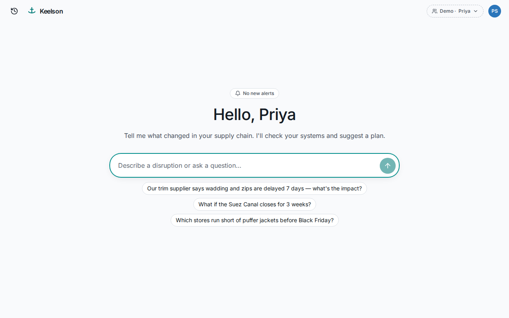 | 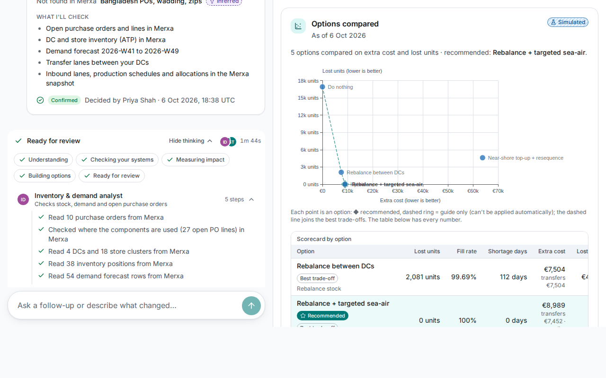 | 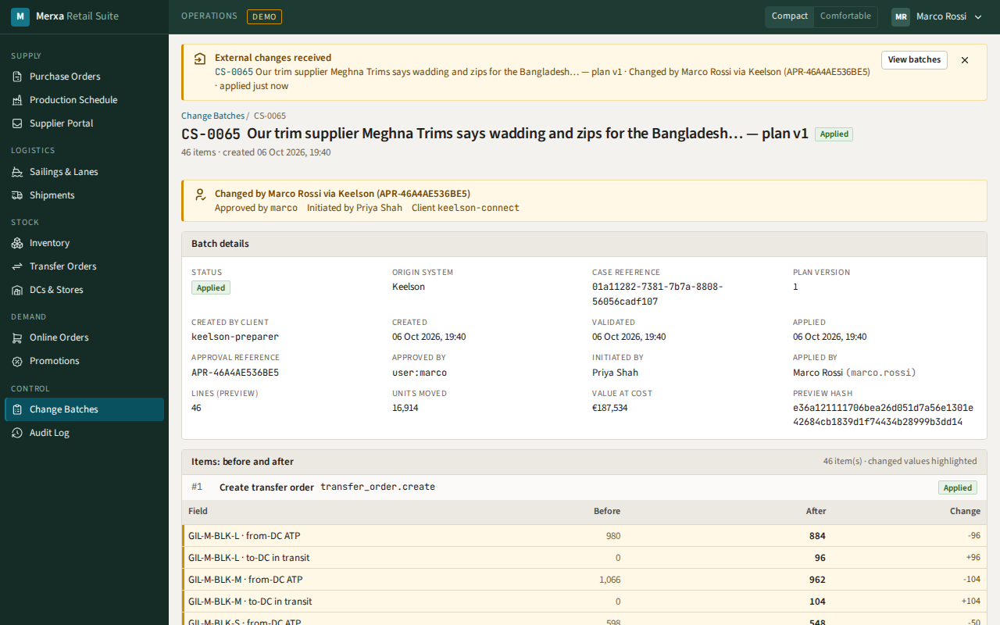 |
| 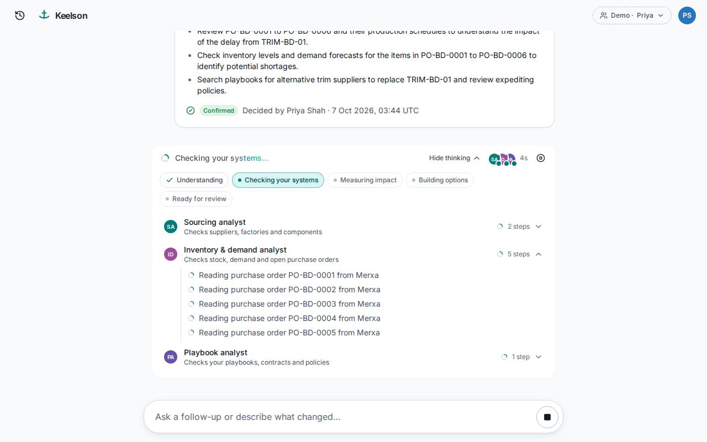 | 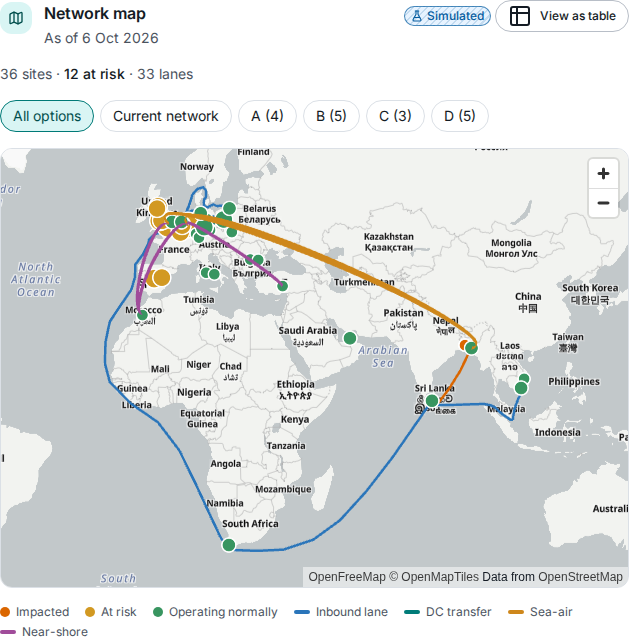 | 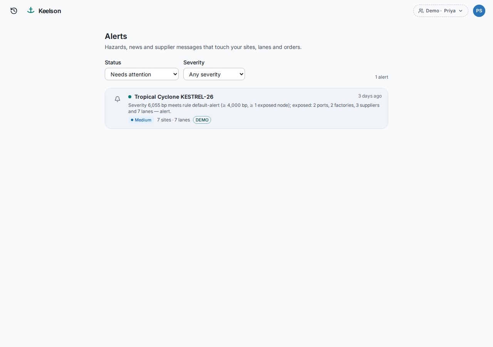 |

---

## Contents

**Understand it**
1. [Why Keelson](#why-keelson)
2. [Key capabilities](#key-capabilities)
3. [What's inside](#whats-inside)
4. [Architecture](#architecture)
5. [How a case flows through Keelson](#how-a-case-flows-through-keelson)
6. [Agents and models](#agents-and-models)
7. [Trust, safety and approvals](#trust-safety-and-approvals)
8. [Optimizer in depth](#optimizer-in-depth)
9. [Signal Hub in depth](#signal-hub-in-depth)
10. [Merxa Retail Suite in depth](#merxa-retail-suite-in-depth)
11. [Connecting any ERP](#connecting-any-erp)
12. [Identity and access](#identity-and-access)
13. [The web apps](#the-web-apps)
14. [Shared packages](#shared-packages)

**Run it**

15. [Prerequisites](#prerequisites)
16. [Quick start](#quick-start)
17. [URLs](#urls)
18. [Default logins](#default-logins)
19. [Demo walkthrough](#demo-walkthrough)
20. [Configuration](#configuration)
21. [Day-to-day operations](#day-to-day-operations)
22. [Testing](#testing)
23. [CI, releases and the software supply chain](#ci-releases-and-the-software-supply-chain)
24. [Deploying to Google Cloud Run](#deploying-to-google-cloud-run)

**Reference**

25. [Repository layout](#repository-layout)
26. [Documentation index](#documentation-index)
27. [Project status](#project-status)
28. [Troubleshooting](#troubleshooting)
29. [Security notes](#security-notes)
30. [Glossary](#glossary)
31. [Licences & attribution](#licences--attribution)

---

## Why Keelson

Retail supply chains break in many small ways: a trim supplier slips a week, a port closes for a typhoon, a canal shuts, a carrier cuts capacity. Planners usually find out late, piece the impact together by hand across several systems, and then re-key the fix screen by screen.

Keelson treats every disruption as a **case**. It does five things for each one:

1. **Senses** the disruption: public hazard and news feeds, webhooks from connected systems, or a plain-language message.
2. **Frames** it as a structured scenario using an event taxonomy (what happened, where, how long, how bad, with likely ranges).
3. **Investigates** it with a team of read-only AI specialists. They pull facts from the ERP, the knowledge base and external intelligence.
4. **Plans** with a deterministic solver. It computes impact (first stock-out dates, time-to-survive) and compares recovery options built from five levers.
5. **Remediates** by turning the chosen option into a change set. A human or policy approves it, Keelson applies it in the vendor's system and reads it back to verify. Alternatively, Keelson guides a person step by step through doing it by hand.

The design rule throughout: **AI investigates and explains; deterministic services compute, validate and commit.** LLMs never invent numbers and never hold write tools.

---

## Key capabilities

**Sensing**
- Polls GDACS, USGS, NOAA NHC, Copernicus EMS, OFAC sanctions lists and trade-press RSS. GDELT and MeteoAlarm are opt-in.
- Ingests connector webhooks (for example, a supplier message or a lane capacity change in Merxa).
- Groups raw signals into events and explains each grouping: same hazard, SimHash near-duplicate, shared place, term/vector similarity.
- Matches events against each tenant's network (sites, lanes, watch regions) with PostGIS and raises alerts. Severe alerts can auto-draft a case.

**Investigation**
- Taxonomy-driven framing of 11 event types in 5 families, with p10/p50/p90 priors.
- A planner LLM breaks the case into tasks. Specialists then run in parallel dependency waves: inventory & demand, sourcing, logistics, playbook (knowledge base), external intelligence, and any tenant-defined custom specialists.
- A deterministic **number verifier** and an LLM **critic** can send the investigation back for one revision.
- Follow-up questions ("what if the delay doubles?") are classified as *explain*, *re-simulate* or *re-investigate*, so only the affected work is redone.

**Planning**
- Impact analysis with a weekly projected-available-balance simulator: units, revenue and margin at risk, first breach week, time-to-survive (TTS) and time-to-recover (TTR).
- Five recovery levers: rebalance between DCs, sea-air expedite, near-shore re-source, allocation prioritisation, factory resequencing.
- Four candidate options plus "do nothing". A plan is never worse than doing nothing.
- Optional CP-SAT stage for whole-unit re-sourcing (MOQ, case packs, shared factory capacity) and resequencing.
- Extra CO₂e per option (GLEC v3 indicative factors) and p10–p90 likely ranges from seeded Monte-Carlo re-simulation.

**Remediation**
- **Apply changes for me**: compile → dry-run in the vendor system → policy or human approval (including four-eyes) → signed approval receipt → apply via MCP → read-back verification.
- **Guide me**: a checklist with prefilled deep links into the vendor UI. Steps tick themselves when the vendor reports the change.
- **Re-plan on new information**: for example, Merxa cuts sea-air capacity to 30% and Keelson proposes a delta plan.
- **Undo changes**: an atomic, human-approved rollback through a compensating change set.

**Platform**
- Multi-tenant with Postgres row-level security on every tenant table.
- A back-office for AI gateway budgets, agent prompts, custom specialists, connectors, mappings, CEL approval policies, knowledge bases, signals, users, tenants and audit.
- Guarded admin changes need a second admin (four-eyes change requests).
- Evals UI with golden and adversarial (prompt-injection) cases, in replay or budgeted live mode.
- LLM record/replay: identical repeat runs cost nothing.
- Runs entirely on a laptop with Docker, or natively on Windows without Docker. A Cloud Run mapping is included.

---

## What's inside

| Part | What it does |
|---|---|
| **Keelson web** (Next.js 16.3, React 19.3) | Gemini-style calm UI with one composer and a live *thinking* timeline (which agents are consulted, plain-language activity). An "approach" card confirms what was understood, recommendation cards present options, and a side **Canvas** holds the rich visuals (network map, impact graph, stock-out timeline, option comparison, plan diff). Also an alerts inbox and a role-gated **back-office** (`/admin`). |
| **Keelson engine** (Python 3.14, FastAPI + Google ADK 2.11) | Graph workflow: intake → taxonomy-driven framing → planner → parallel specialists → verify numbers → critic → deterministic impact & optimisation → recommendation → approvals (policy rules, four-eyes, capped auto-commit) → apply via MCP → read-back → re-plan on new information → rollback. LLMs never invent numbers and never hold write tools. |
| **Optimizer** (OR-Tools 9.15) | Deterministic impact analysis (first stock-out dates, time-to-survive) and five recovery levers. Opt-in CP-SAT stage for whole-unit re-sourcing and resequencing. Extra CO₂e per option, and p10–p90 likely ranges from seeded sampling of the same decisions. |
| **Signal Hub** | Polls hazard, sanctions and trade-press feeds, plus connector events. Groups them into events (each grouping explained), matches exposure against each client's network and raises alerts. Replayable demo packs: typhoon, trim delay, Suez, port-strike syndication, Cape-route hurricane. |
| **LiteLLM** (1.104) | A single gateway for every chat and embedding model, with per-tenant virtual keys, budgets and usage. Gemini by default, **Flash/Flash-Lite only**. Managed from Keelson's *AI Gateway* admin page. |
| **Keycloak** (26.8) | Two identity worlds: realm `keelson` (our product) and realm `merxa` (the vendor). OAuth/MCP between them, with a delegated approver identity for writes. |
| **Adapter sidecar** (template) | A FastMCP service that puts `scn/1.0` snapshot export, a change feed and a change-set facade (validate / apply / rollback) in front of a CSV, SQL or REST system, so any ERP can be connected at tiers B·C·W. Demo instance: the CSV-backed "Fernhill ERP" (compose profile `adapters`). |
| **Merxa Retail Suite** (FastAPI + Next.js) | The mock vendor ERP, with its own database, realm and design system. Offers REST, an MCP server (`/mcp`), a plain "foreign ERP" MCP profile (`/mcp-lite`), change sets with dry-run/apply/rollback, signed webhooks, Parquet snapshot export, prefilled forms for guided steps and a demo director. |
| **Evals** | Black-box HTTP evaluations against the running stack: golden cases plus prompt-injection attacks. Available as a CLI and as an in-app runner behind `/admin/evals`. |
| **Infrastructure** | Caddy edge proxy, Squid egress proxy, Postgres 18 (+ PostGIS, pgvector), Valkey 8, optional Arize Phoenix tracing, self-hosted Protomaps base map. |

---

## Architecture

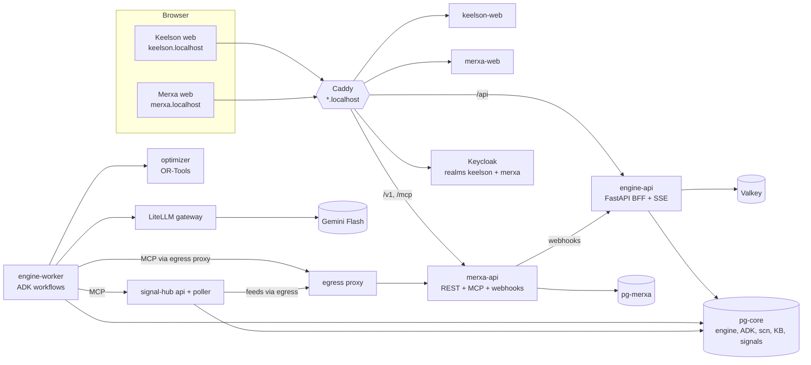

### Design principles

- **AI investigates and explains; deterministic services compute, validate and commit.** Only deterministic workflow nodes write data, create UI blocks or emit assistant text.
- **Every value carries provenance**: `fact` (read from a system), `inference` (LLM claim), `assumption` (prior or template default), `simulated` (solver output), `decision` (stated by a human) or `committed` (applied in the target system, plus a `verified` flag after read-back).
- **The vendor is a stranger.** Merxa has its own database, identity realm, design system and lockfile. Keelson reaches it only through published interfaces, and Merxa's web app is lint-banned from importing any `@keelson/*` package.
- **Postgres is the source of truth.** Postgres is the run queue and the event log; Valkey only wakes things up. Losing a Valkey message never loses data.
- **Fail closed.** Policies, LLM replay misses, the LiteLLM gateway (`allow_requests_on_db_unavailable: false`), approval-hash mismatches and the evals runner all refuse rather than guess.

### Processes and networks

Compose project name: `keelson`. Only Caddy publishes a host port (`80:80`). Services are split across four bridge networks:

| Network | Who is on it |
|---|---|
| `edge` | Caddy, egress, Keycloak, merxa-api, merxa-web, keelson-web, engine-api, optional sidecars and tools |
| `app` | Caddy, egress, Keycloak, kc-config, pg-core, Valkey, optimizer, bootstrap, engine-api, engine-worker, Signal Hub |
| `ai` | Caddy, LiteLLM, pg-litellm, bootstrap, engine-api, engine-worker, Signal Hub bootstrap and API |
| `vendor` | merxa-api, pg-merxa |

Outbound traffic to connectors and public feeds goes through the **Squid egress proxy** (`http://egress:3128`). Its policy is "deny internal, allow public": private, loopback, link-local (cloud metadata), CGNAT and ULA destinations are refused based on the resolved IP. The dev hostnames `merxa.localhost`, `fernhill.localhost` and `auth.localhost/realms/merxa` are explicitly allowed.

### Compose services

| Service | Purpose | Profile | Memory |
|---|---|---|---|
| `caddy` | Edge proxy for every `*.localhost` hostname | – | 96 MB |
| `egress` | Squid forward proxy for outbound calls | – | 128 MB |
| `keycloak` | Identity provider (realms `keelson`, `merxa`) | – | 900 MB |
| `kc-config` | One-shot realm upsert on every boot (keycloak-config-cli) | – | 512 MB |
| `pg-core` | Postgres 18 + PostGIS 3.6 + pgvector 0.8 — databases `keelson`, `adk`, `keycloak`, `signals` | – | 384 MB |
| `pg-litellm` | LiteLLM's database | – | 256 MB |
| `pg-merxa` | Merxa's database | – | 320 MB |
| `valkey` | Wake-up streams and SSE tail (AOF, `noeviction`) | – | 128 MB |
| `litellm` | AI gateway; needs `GEMINI_API_KEY` from the host | – | 1200 MB |
| `merxa-api` | Mock vendor ERP backend (REST, MCP, webhooks, snapshots) | – | 384 MB |
| `merxa-web` | Mock vendor ERP UI | – | 256 MB |
| `optimizer` | OR-Tools impact + levers | – | 512 MB |
| `bootstrap` | One-shot: migrations, tenants, LiteLLM aliases/keys, connectors, packs, KB seed | – | 512 MB |
| `engine-api` | FastAPI BFF, REST, SSE, back-office API | – | 512 MB |
| `engine-worker` | Google ADK workflow runtime | – | 1024 MB |
| `keelson-web` | Keelson UI | – | 384 MB |
| `signal-hub-bootstrap` | One-shot: `signals` role/database/extensions, migrations, news-extraction LLM key | – | 192 MB |
| `signal-hub-api` | Signal Hub REST + MCP + demo feeds (internal only) | – | 256 MB |
| `signal-hub-poller` | Feed poller (single leader, egress only, no LLM key) | – | 256 MB |
| `fernhill-sidecar` | Adapter sidecar demo in front of a CSV "Fernhill ERP" | `adapters` | 256 MB |
| `basemap-fetch` | One-shot Protomaps base-map download | `basemap` | 384 MB |
| `evals-runner` | In-app evaluation runner (read-only filesystem) | `evals` | 256 MB |
| `phoenix` | Arize Phoenix traces | `obs` | 768 MB |

Every image is pinned as `tag@sha256`. Our own images run as non-root uid `10001`.

---

## How a case flows through Keelson

### The workflow graph

The engine builds one Google ADK `Workflow` per tenant agent spec (`services/engine/src/keelson_engine/runtime/workflow.py`). Every router has a default route, so no run can fall off the graph.

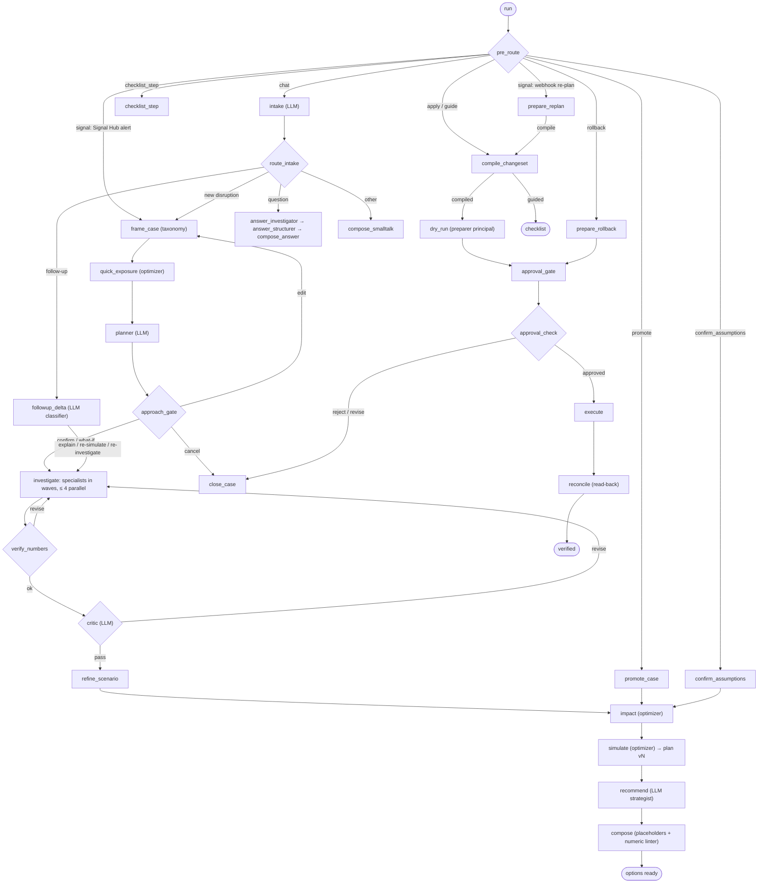

**LLM nodes:** intake, answer investigator/structurer, planner, each specialist's investigator and structurer, guard, extractor, critic, recommend, recommender repair and the follow-up classifier. **Everything else is deterministic.** The number verifier and the critic share a single revision budget per run.

### Stages the user sees

`understanding` → `checking_systems` → `measuring_impact` → `building_options` → `ready_for_review` → `preparing_changes` → `awaiting_approval` → `applying` → `verified`

### Runs, queueing and streaming

- `POST /api/cases/{id}/messages` (or `/actions`) inserts a `run` row (`status=queued`; kind `chat`, `action`, `signal` or `resume`) and wakes the worker through the Valkey stream `keelson:runs:wake`.
- The worker claims runs with `FOR UPDATE SKIP LOCKED`, and a unique index allows **one running run per case**. Leases last 60 s with a 15 s heartbeat. Expired leases are re-queued as `crash_retry`, and after 3 attempts the run fails with `CRASH_LIMIT`. Without a wake-up, the worker polls every 5 s.
- Every event is written to `run_event` in Postgres first, then published to `keelson:case:<id>` in Valkey. The SSE endpoint replays from Postgres and then tails Valkey.
- Events follow the **AG-UI 1.0** protocol: `RUN_*`, `STEP_*`, `SUBAGENT_*`, `TOOL_CALL_*`, `REASONING_*` (live only), `ACTIVITY_SNAPSHOT` (UI blocks), `TEXT_MESSAGE_*` and `CUSTOM` (`sc.case.updated`, `sc.alert.*`). Each event carries `metadata.sc` with tenant, case, sequence number, stage, provenance, agent, evidence references and run id.

### Case modes and lifecycle

- `actual` vs `what_if`: a "what if…" message makes the case hypothetical. **Apply stays disabled** on a what-if until the user clicks **Promote to actual**, which re-simulates on the current snapshot and produces plan *v+1*.
- Unconfirmed assumptions (inferences and template defaults) block Apply until the user confirms them.
- Case statuses: `open` → `awaiting_approval` → `committed` → `closed`. Plan statuses: `proposed`, `committed`, `superseded`, `rolled_back`.
- Each re-plan creates a new plan version. The UI shows "Updated · Plan v2" and lets you compare versions.

### Numbers are never invented

- The LLM writes narrative with **placeholders** only: `{{kpi:<option>.<key>}}`, `{{ev:<evidence-id>#<json-pointer>}}`, `{{calc:<id>}}`. The deterministic `compose` node fills them in.
- A **numeric linter** then allows digits only inside resolved tokens. It gives the model one repair turn, and after that any offending sentence is stripped.
- `verify_numbers` sends the investigation back if more than 20% of numeric claims do not resolve to evidence.
- Every tool result is stored as an `evidence` row with an `_evidence_id`, so each figure in the UI can be traced to its source.

### Follow-ups and the knowledge base

- `followup_delta` classifies a follow-up as **EXPLAIN** (just answer), **RESIMULATE** (same facts, new parameters) or **REINVESTIGATE** (new facts needed). It then computes the "dirty" task set deterministically, and each answer ends with a *what changed* line.
- The knowledge base uses pgvector with one table per embedding profile and HNSW cosine indexes. Uploads can be `.md`, `.txt` or `.pdf` up to 5 MB; PDFs are parsed in a resource-limited child process. Chunks follow headings (about 600 tokens, 80 overlap), and search returns the top 6. Re-embedding builds a shadow table and swaps it in.
- The demo tenant is seeded with five synthetic documents (`data/kb/demo-retail`): a peak-trading continuity playbook, a trim supply-agreement extract, a freight expedite policy, a near-shore responsible-sourcing code and a DC-to-DC transfer SOP.

---

## Agents and models

### Specialists

Each specialist is a wrapper node. An *investigator* (LLM with read-only tools) runs first, then a *structurer* (LLM) that emits typed `Findings`.

| Specialist | Read tools | Quarantined (untrusted) source |
|---|---|---|
| Inventory & demand analyst (`inventory_demand`) | inventory, demand forecast, allocations, POs, locations, BOM where-used | – |
| Sourcing analyst (`sourcing`) | POs, BOM, factory schedule, entity search | supplier messages |
| Logistics analyst (`logistics`) | sailings, shipments, lane options, POs | system events |
| Playbook analyst (`playbook`) | – | knowledge base |
| External intelligence (`external_intel`) | – | Signal Hub |
| Custom specialists | tenant-defined in the back-office (prompt, tool allowlist, playground) | as configured |

The other roles are **Intake**, **Planner**, **Critic** and **Strategist** (the recommender).

### Model aliases

Every model call goes through LiteLLM with the tenant's virtual key and an alias. The concrete model ids are pinned in [`models.lock`](models.lock):

| Alias | Model | Setting | Used by |
|---|---|---|---|
| `reasoning-default` | `gemini-3.8-flash` | reasoning effort medium | planner, strategist |
| `fast-default` | `gemini-3.8-flash` | reasoning effort low | intake, investigators, structurers, answers, follow-ups |
| `critic-default` | `gemini-3.8-flash` | reasoning effort low | critic (must differ from the planner's alias) |
| `extract-fast` | `gemini-3.5-flash-lite` | reasoning effort minimal | untrusted-text extractor, news extraction |
| `guard-default` | `gemini-3.5-flash-lite` | reasoning effort minimal | prompt-injection guard |
| `embed-default` | `gemini-embedding-001` | 1536 dimensions | knowledge base, optional signal embeddings |

There are no Pro models by design. Changing an alias changes the LLM replay key, so its recordings miss and are re-recorded.

### Budgets

| Limit | Value |
|---|---|
| LLM calls per run | 90 (platform ceiling `PLATFORM_MAX_LLM_CALLS` = 120) |
| Tokens per run | 1.2 M (platform ceiling `PLATFORM_MAX_TOTAL_TOKENS` = 2 M) |
| Tool calls per specialist | 15 |
| Tasks per investigation plan | 6, at most 4 in parallel |
| Tenant budgets | `demo-retail`: €50, 120 rpm, 400k tpm · `northwind-test`: €1, 10 rpm, 20k tpm |
| Signal Hub news-extraction key | $5 per 30 days |

### LLM record/replay

`LLM_REPLAY_MODE` controls the engine's record/replay layer (`runtime/replay.py`, table `llm_replay`):

| Mode | Behaviour |
|---|---|
| `off` | Code default; **required in production** |
| `record` | Call the model and store the response |
| `replay` | Serve stored responses only; a miss fails the run with `LLM_REPLAY_MISS` |
| `record_or_replay` | Compose default for local dev: replay if present, otherwise call and record |

The replay key is a SHA-256 of the normalised request: alias, the `models.lock` fingerprint, agent, task, spec version, the full generation config, the contents and the call's occurrence number in the run. Run-specific ids are replaced with placeholders and re-mapped on replay. Replayed calls report zero usage, so **identical repeat runs cost nothing**.

---

## Trust, safety and approvals

### Untrusted text quarantine

Supplier messages, ERP event text, knowledge-base chunks and news are **never** bound to an agent that also has tools. The investigator gets a wrapper tool instead, which:

1. fetches the text deterministically and stores the raw evidence;
2. screens each text with a pattern check plus the `guard` agent, dropping and auditing anything flagged (`untrusted_text.flagged`);
3. runs the `extractor` agent to produce a strict structured extract (quotes ≤ 200 characters);
4. returns only `{source_evidence_id, kind, entity_mentions, delay_days}` to the investigator, labelled `inference`.

Guard and extractor events are never streamed or persisted. Values derived from untrusted text **taint** the case: they need human confirmation and are never auto-approved.

### Approval policies (CEL)

Policies are CEL rules in the versioned agent spec, evaluated in ascending priority. The first match wins, and evaluation fails closed. Default rule set:

| Priority | Rule | Effect |
|---|---|---|
| 10 | `refuse-unconfirmed` | A what-if or unconfirmed input → **refuse** |
| 20 | `four-eyes` | Cost > €10,000, or ops `po.create` / `po_line.cancel` / `production_order.resequence` → **approver + compliance**, 2 people, initiator excluded |
| 30 | `human-untrusted` | Non-chat origin or tainted input → **one approver** |
| 40 | `auto-small-transfer` | Only transfer/allocation ops, ≤ 10 lines, ≤ 500 units, planner-initiated → **auto-commit** |
| 50 | `default` | **One approver** |

Two hard floors apply whatever the rules say: what-if or unconfirmed input is refused, and auto-commit is only possible for a person's own chat run on untainted input. **Signal- and webhook-originated runs are never auto-approved.** Tenant admins edit rules in *Admin → Policies* with a CEL editor and a test bench.

### Commit pipeline

1. **Compile.** The chosen option is compiled into one change set per connector. Options whose operations the connector cannot apply are marked `guided_only`.
2. **Dry-run.** The *preparer* principal validates the set in the vendor system. The vendor's `preview_hash` must equal Keelson's canonical change-set hash.
3. **Approve.** The policy decides who must approve. Quorum is counted by maximum matching across roles. Approval requires the current `change_set_hash` and `plan_version`; a stale approval gets 409.
4. **Receipt.** Keelson signs an **approval receipt** JWT (ES256, kid `ar-1`, `typ: approval-receipt+jwt`, JWKS at `/api/.well-known/jwks.json`). It carries `approved_by` (`user:<u>` or `policy:<rule>@<version>`), `co_approved_by` for four-eyes, and the approver's external subject.
5. **Apply.** The executor's delegated Merxa token applies the set over MCP with an idempotency key (`sha256(tenant|change_set_id|revision)`). Auto-commits use the separate `autocommit` principal and are capped by the vendor (≤ 50 items, ≤ 5,000 units, transfer/allocation ops only).
6. **Read back.** `reconcile` reads every change back with the *reader* principal and marks it `verified`. The per-operation ledger tracks `attempted`, `succeeded`, `in_doubt`, `failed` and `verified`.
7. **Undo.** Rollback always needs a human approval. Merxa builds a compensating change set of inverse operations, applies it atomically and refuses (409) if anything changed since.

### Guide mode

When a user picks **Guide me**, or an option is guided-only, Keelson produces a `remediation_checklist`. Each step has instructions and a **deep link** that opens the vendor form already filled in, for example `/transfer-orders/new?from=…&to=…&lines=SKU:qty`. A step ticks itself to *Verified* when the vendor's webhook arrives or on a 60-second read-back poll. Mixed plans read like "Apply 3 changes for me · Guide me through 2".

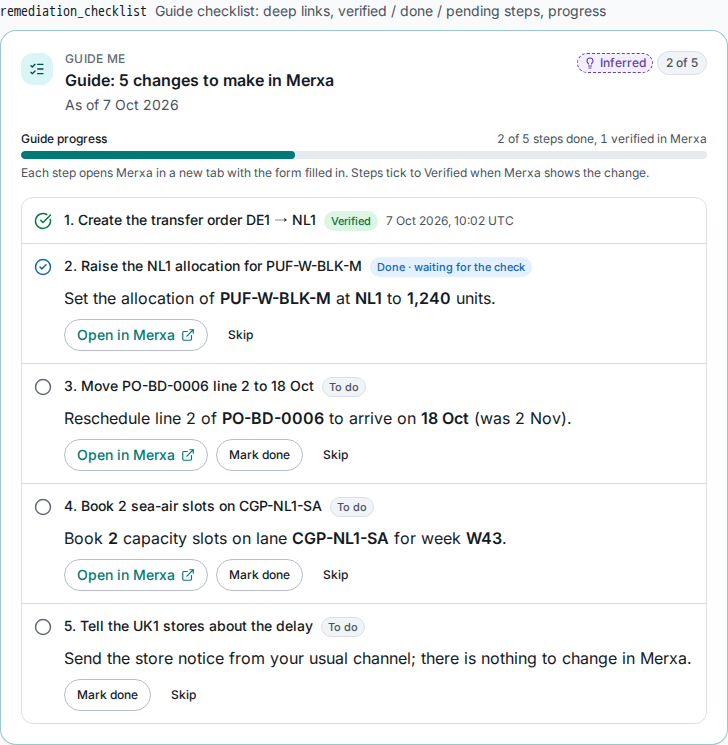

### Re-plan on new information

Webhook events listed in `REPLAN_EVENT_TYPES` (default `lane.capacity_changed`) start a `signal` run on affected cases. Keelson recomputes, shows a **"New information: … — plan updated (v2)"** banner and offers **Compare v1 and v2**. The delta plan then goes through the same approval and commit pipeline.

---

## Optimizer in depth

`services/optimizer` (`keelson_opt`) is a stateless, deterministic FastAPI service on port 8200. It is internal only, authenticated with an HS256 service JWT, and uses OR-Tools 9.15 (GLOP for LPs, CP-SAT for integer and sequencing stages).

| Endpoint | Purpose |
|---|---|
| `GET /v1/levers` | The lever catalogue (`code`, `title`, `params_schema`, `ops`) |
| `POST /v1/impact` | Impact analysis; `include_graph` adds the impact graph, TTS and bottlenecks |
| `POST /v1/optimize` | Build and score recovery options |
| `GET /healthz`, `GET /readyz` | Health checks |

### Impact analysis

- A weekly (ISO week) **projected available balance** simulator per DC × SKU × week. Shortages are rationed fair-share across store clusters, and lost sales are not backordered.
- KPIs: `units_at_risk`, `revenue_at_risk_cents`, `margin_at_risk_cents`, `shortage_cluster_weeks`, and the **first breach** (the earliest week below protected minimum, per DC × cluster × style).
- Perturbations: `lead_time_shift`, `demand_scale`, `capacity_scale` (0 closes a lane: receipts are delayed, rerouted to the alternate lane, or lost) and `compliance_block`.
- **Time-to-survive** is computed with a Simchi-Levi LP per DC, alongside **time-to-recover**. The verdict is `ok`, `expedite` or `loss`. Bottlenecks list the top 25 binding SKU-weeks with their dual values.
- An impact graph of up to 300 nodes, each `disrupted`, `impacted`, `at_risk` or `ok`.

### The five levers

| Lever | What it does | Vendor operations |
|---|---|---|
| `reallocate_inventory`: *Rebalance inventory between DCs* | LP over transfers per lane × SKU × ship week, within available-to-promise and lane caps | `transfer_order.create` |
| `expedite_mode_shift`: *Expedite by sea-air / air* | Splits PO lines onto a faster lane within weekly capacity and a premium cap | `po_line.split` |
| `resource_alt_supplier`: *Re-source from an alternate supplier* | Buys from approved, compliant near-shore sources within MOQ and capacity | `po.create` + `po_line.change_qty` / `po_line.cancel` (atomic group) |
| `prioritize_allocation`: *Prioritise allocation across clusters* | A single-week optimum rule that respects protected minimums | `allocation.set_qty` |
| `resequence_production`: *Resequence factory production* | Smith's rule, exact enumeration (≤ 7 orders), CP-SAT (≤ 40) or greedy | `production_order.resequence` + `po_line.reschedule` |

### Options and pipeline

The engine asks for four candidate options plus a baseline:

| Option | Levers |
|---|---|
| A — *Rebalance between DCs* | reallocate |
| B — *Rebalance + targeted sea-air* | reallocate + expedite |
| C — *Near-shore top-up + resequence* | re-source + resequence |
| D — *Hybrid* | all enabled levers |
| *Do nothing* | – |

The pipeline runs in this order: resequence first, then one composed LP, then a deterministic integer repair (floor, MOQ top-up or drop, re-solve), then allocation prioritisation. A final guard enforces **"never worse than doing nothing"**: if a plan would be worse, the do-nothing plan is returned instead. KPIs and the scorecard are always recomputed by the simulator. Scorecard fields: fill rate, lost units and margin, incremental cost (transfer, expedite premium, near-shore premium), net benefit, shortage days, first-breach shift, TTS gain and the number of changes.

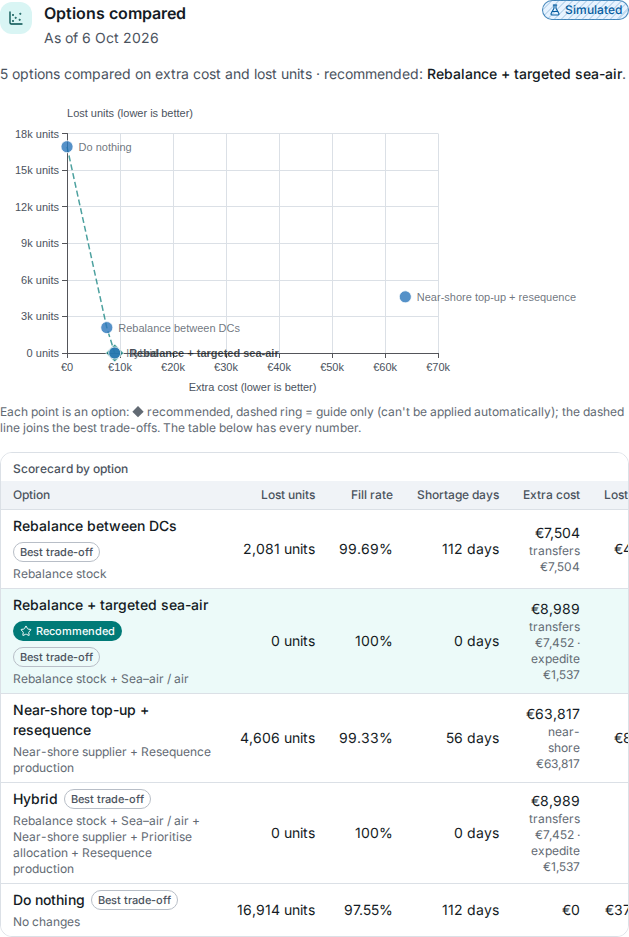

### CP-SAT stage (opt-in)

Set `integer_stage: "cpsat"` (*Admin → Agents → Planning solver*) to switch from LP rounding to a whole-unit model. It handles case packs (`order_multiple_units`), MOQ per PO or per style-colour, shared factory capacity groups, maximum orders, and at most one buy per PO line. Resequencing v2 uses a time-indexed CP-SAT model with frozen days and lateness costs. Solves are deterministic: 1 worker, a seeded run and deterministic time limits. In the Bangladesh trim story, option C's net benefit rises from 13.85 M to 16.13 M cents.

### CO₂e and likely ranges

- **CO₂e:** lane intensity is the sum over legs of km × g CO₂e per tonne-km. Factors come from [`data/emissions/factors.yaml`](data/emissions/factors.yaml) (GLEC Framework v3, well-to-wheel, indicative: sea 16, air 850, road 100, rail 25). Each scorecard shows the extra kg for transfers, expedites, near-shoring (which can be negative) and re-bookings. Figures are labelled *indicative* because the factors are not verified.
- **Robustness (`mc/1`):** the rounded plan and the do-nothing baseline are **re-simulated, never re-optimised**, across 8–256 samples (default 64) of value, window, lead-time and demand noise. Draws are seeded with BLAKE2b and use common random numbers across options. The output is p10/p50/p90 bands per KPI plus a stock-out chance.

**Performance:** the full profile (180 SKUs, 18 clusters, 9 weeks) with all five levers solves in about 2.8 s at 512 MB / 1.5 CPU. Adding 64 robustness samples takes about 3 s.

---

## Signal Hub in depth

`services/signal-hub` runs as three processes from one image:

- **`signal-hub-bootstrap`** creates the `signals` database (PostGIS + pgvector), runs migrations and provisions a dedicated news-extraction LLM key.
- **`signal-hub-api`** (port 8300, internal only) serves REST `/v1`, read-only MCP `/mcp` and demo feeds. It also runs background loops for extraction retries, expiry and cluster maintenance.
- **`signal-hub-poller`** polls feeds. Leadership is a Postgres advisory lock, it can only reach the internet through the egress proxy, and it holds no LLM key, shared secret or data key.

### Feeds

| Adapter | Source | Provenance | Licence | Default cadence | Default |
|---|---|---|---|---|---|
| `gdacs` | GDACS event list + geometries | fact | CC BY 4.0 | 10 min | on |
| `usgs` | USGS M4.5+ earthquakes (day) | fact | public domain | 5 min | on |
| `rss.*` | Trade press (default: The Loadstar) | inference after quarantine | headline + ≤ 300-char snippet + link | 15 min | on |
| `nhc` | NOAA NHC current storms + cone/track KMZ | fact | public domain | 15 min | on |
| `copernicus_ems` | Copernicus EMS rapid-mapping activations | fact | © EU, attribution | 30 min | on |
| `ofac` | OFAC Sanctions List Service (SDN/ALT/ADD) | fact (organisations only) | public domain | 60 min | on |
| `gdelt` | GDELT 2.0 15-minute export | inference (severity capped below alert) | citation required | 15 min | tenant opt-in |
| `meteoalarm.<cc>` | MeteoAlarm Atom + CAP (orange/red only) | fact | redistribution terms apply | 15 min | off |
| `connector` | Connector webhooks (e.g. Merxa) | fact or inference | – | push | – |

Fetching uses conditional GETs, a 12 MiB response cap, a destination guard on every redirect hop, and exponential back-off on failure (capped at 1 h). Trade-press text goes through the same guard → extractor quarantine as the engine, with a strict `NewsExtraction` schema.

### Clustering: from signals to events

Rules are applied in order, and the first match wins:

1. **`same_hazard` / `anchor`**: authoritative sources (GDACS, USGS, NHC, Copernicus EMS, OFAC) anchor an event. The same hazard within 100 km and 72 h (storms, floods, wildfires) or 6 h (others) joins it.
2. **`near_duplicate`**: a 64-bit **SimHash** (NFKC + casefold, unigrams + bigrams, keyed BLAKE2b, eight 8-bit bands in a GIN index) within 6 bits over 72 h. Near-duplicates add no corroboration, so syndicated copies of one story don't inflate confidence.
3. **`attach_ref` / `attach_geo`**: a shared place reference (UN/LOCODE, chokepoint, country, region) or within 300 km.
4. **`attach_vector`**: term-vector cosine similarity (places and companies weighted). This requires a shared place or company word. Local thresholds are attach 7000 bp and merge/strict 7500 bp; optional remote embeddings through LiteLLM and pgvector use stricter thresholds.
5. **`founded`**: otherwise a new event.

Every membership stores a **deterministic explanation** built only from the method, integers, place codes and gazetteer names (never a headline). The alert drawer shows it as "why are these grouped?". Thresholds are platform settings (`/admin/signals` → Clustering).

### Exposure and alerts

- **Exposure** is computed in PostGIS against the tenant network and watch regions. Match types, in order of precedence: `intersects` (10000), `entity_match` (10000; includes OFAC name keys), `lane_crosses` (9000, or 7000 within 25 km) and `dwithin_km` (linear falloff). Event radii depend on type, for example tropical cyclone 300 km, M ≥ 6.5 earthquake 250 km, port closure 10 km.
- **Watch regions:** a radius around a node or lane (1–2000 km) or a polygon. Up to 100 per tenant.
- **Alert rules:** by default, alert at severity ≥ 4000 bp with at least one exposed node. At ≥ 7000 bp with an exposed supplier, factory or port, the rule is *alert and draft a case*. There is one alert per tenant and event, with hysteresis before re-notifying. The *why* is a deterministic sentence.
- **Confidence** = authority × corroboration × recency.
- **MCP tools** for the engine: `search_signals`, `get_event`, `hazards_near_node`, `assess_exposure`. News-bearing results are marked `content_trust: "untrusted_text"`.

### Demo scenario packs

Packs live in [`data/scenarios/`](data/scenarios). Each has a `pack.yaml`, fixtures, a README and `expected.yaml`. Payloads go through the **real** adapters with a simulated clock and deterministic ids, so reset-and-replay is identical. Packs need no LLM (extractions are pre-baked).

| Pack | Story | Outcome |
|---|---|---|
| `typhoon-hcmc` | Fictional Typhoon KESTREL-26: 4 GDACS advisories (Orange → Red) + "Cat Lai suspends operations" | Alert at 6055 bp; Red (8780 bp) auto-drafts a case. Exposes ~7 sites (Saigon port, a Vietnamese factory and supplier, Cambodian nodes) and 7 lanes |
| `a-outerwear-trim-delay` | Merxa supplier message: trims delayed 7 days at Meghna Trims; plus a cold-snap item | Entity-match alert at 4500 bp; weather item is context only |
| `suez-closure` | 3 trade-press items from 2 outlets: Suez / Bab-el-Mandeb | 7500 bp, lanes only (no case drafted) |
| `port-strike-syndication` | Hamburg strike syndicated across outlets | Shows founded → near-duplicate → vector attach grouping |
| `hurricane-cape-route` | Fictional Hurricane ALBATROSS: 3 NHC advisories (cat 1 → 3) with cone/track | Exposes 4 Cape-route lanes, no sites |

`data/scenarios/validate.py` checks packs offline at three levels (`shape`, `contract`, `replay`). It compares exactly against `expected.yaml` and flags anything within 5 km of a threshold as fragile.

---

## Merxa Retail Suite in depth

Merxa is a fictional ERP from "Merxa Systems". It exists to prove Keelson can work with a system it does not own.

- **merxa-api**: FastAPI on port 8100 with its own Postgres 18 (`pg-merxa`). A standalone project with no Keelson imports.
- **merxa-web**: Next.js 16.3 on port 3001, AG Grid Community (Balham theme), Source Sans 3 + JetBrains Mono, its own tokens and its own lockfile.

### Data model

| Area | Entities |
|---|---|
| Network | markets, DCs, store clusters (DC × climate × grade band, e.g. `UK1-COLD-A`), stores |
| Sourcing | suppliers (trim / fabric / CMT), factories, components, BOM lines, factory lines, line calendars, production orders |
| Items | styles (style-colours), SKUs (`<style>-<size>`, e.g. `PUF-W-BLK-M`) |
| Orders & stock | purchase orders + lines, inventory positions (enforced `on_hand − allocated − reserved ≥ 0`), demand forecasts (style × store × ISO week), size curves, allocations, transfer orders |
| Logistics | ports, carriers, lanes (with chokepoints and alternate lanes), temporal rate cards, sailings, capacity bookings, shipments |
| Sales | online orders, promotions, sales history |
| Control | change sets + items, idempotency records, append-only audit log, outbox, API keys, webhook subscriptions and deliveries, snapshots, supplier messages (untrusted free text) |

### Seed profiles (`SEED_PROFILE`)

| | `small` (fast tests) | `full` (demo default) |
|---|---|---|
| DCs | 4: UK1 Thurrock, NL1 Venlo, DE1 Erfurt, PL1 Poznań | same |
| Store clusters | 12 | 18 |
| Stores | 62 in 9 markets | **451 in 16 markets** |
| SKUs | 30 (5 puffer style-colours × 6 sizes) | **180** (Outerwear 15 + Knit 15 style-colours × 6 sizes) |
| Purchase orders | 7 | 12 (Bangladesh, Cambodia, Vietnam, Türkiye) |
| Online orders | 80 | 600 |
| Size | – | ~410k rows; 81,900 store inventory positions |

Both profiles share 11 ports, 26 lanes (Vietnam sea lanes go via Suez, with Cape alternates at +12 days, and there is a sea-air lane via Jebel Ali), 4 sailings, 3 Black Friday promotions and sales history. The seed is deterministic, with golden hashes pinned in tests. Built-in stories:

- Bangladesh trim delay +7 days → UK1/NL1 short in W45–W46 (16,904 units at risk on `full`).
- Port VNSGN closed 10 days → knit shortage at DE1/PL1.
- Suez closed 21 days → knit short at DE1/PL1 in W46–W48.

### Interfaces

- **REST `/v1`**: cursor pagination, RFC 9457 problem errors, `If-Match` on `PATCH` and `Idempotency-Key` on `POST`. Covers reads for every entity, change sets (`:validate`, `:apply`, `:rollback`, operator guide), manual edits, snapshots, admin (API keys, webhooks, OAuth clients), auth and the demo scenario controls. OpenAPI is at `/v1/docs`.
- **MCP `/mcp`** (FastMCP, stateless streamable HTTP, Bearer JWT from realm `merxa`):
  - **25 read tools**, including `search_entities`, `get_inventory`, `get_demand_forecast`, `list_purchase_orders`, `get_bom_where_used`, `get_lane_options`, `get_factory_schedule`, `list_supplier_messages`, `get_operator_guide` and `scn.snapshot_open` / `scn.snapshot_export` / `scn.changes_since`.
  - **5 write tools**: `create_change_set`, `add_change_set_items`, `validate_change_set`, `apply_change_set`, `rollback_change_set`. Scopes are checked per call.
- **MCP `/mcp-lite`**: a deliberately un-curated "foreign ERP" profile with `list_items`, `get_item`, `update_item` and `create_transfer_order`, authenticated by an API key or JWT. It proves Keelson can work with an arbitrary MCP server.

### Change sets

- **Statuses:** `draft` → `validated` → `applying` → `applied`, or `conflict` / `failed` / `rolled_back`.
- **Validate** simulates available-to-promise and lane capacity, stores before/after per item and returns a `preview_hash`.
- **Apply** requires a matching hash and an ES256 approval receipt. It runs in one transaction with two phases (lock and collect *all* conflicts, then mutate), so it is all or nothing. It writes the audit trail, the outbox event and the attribution **"Changed by Marco Rossi via Keelson (APR-…)"**.
- **Rollback** needs a fresh, bound user receipt. Records created by the change set are cancelled, never deleted.
- **13 operations:** `transfer_order.create`, `allocation.set_qty`, `po_line.reschedule`, `po_line.change_qty`, `po_line.cancel`, `po.create`, `po_line.split`, `capacity_booking.create`, `capacity_booking.cancel`, `production_order.resequence`, `promotion.reschedule`, `online_order.repromise`, plus internal `revert.*`.

### Webhooks, snapshots and the demo director

- **Webhooks** follow the Standard Webhooks spec: HMAC-SHA256 `webhook-signature`, AES-GCM encrypted secrets, and retries after 1 s, 5 s, 30 s, 2 min and 10 min. There are 13 event types, including `change_set.applied`, `po_line.eta_changed`, `supplier_message.received`, `lane.capacity_changed` and `allocation.updated`.
- **Parquet snapshots** (`scn/1.0`) are written in one REPEATABLE READ transaction as zstd parts of ≤ 50k rows, with HMAC-signed URLs that expire after 2 h.
- **Demo director** (`DEMO_MODE=1`, role `merxa-admin`): reset the scenario (2–5 s on `full`), advance the clock, or inject `trim_delay`, `supplier_message`, `po_eta_change`, `inventory_adjust`, `port_closure`, `typhoon` or `lane_capacity` events.

---

## Connecting any ERP

Keelson is not tied to Merxa. Connectors are registered per tenant in *Admin → Connectors* and classified into capability **tiers**:

| Tier | Capability | How Keelson uses it |
|---|---|---|
| **A** | Any MCP tools | Tools are classified (read / write / untrusted text). Read and action **mappings** translate them to the canonical model |
| **B** | `scn/1.0` snapshot export | Fast, consistent bulk sync into Keelson's canonical tables |
| **C** | `scn.changes_since` change feed | Incremental sync (polled every 300 s) |
| **W** | Change-set facade (validate / apply / rollback) | Full "apply for me" with dry-run and read-back |

### The canonical model: `scn/1.0`

15 entities: `location`, `item`, `bom_line`, `lane`, `lane_rate`, `sailing`, `po_line`, `production_order`, `inventory_position`, `demand_forecast`, `size_curve`, `allocation`, `transfer_order_line`, `online_order_line` and `promotion`. Quantities and money are integers (minor units), weeks are `YYYY-Www`, and every row keeps `source_id` and `src_version`.

Keelson's sync downloads the parts and checks them against SHA-256 and size. In one transaction it COPYs them into row-level-secured `scn_*` tables and flips a `scn_current` pointer, keeping 2 superseded snapshots. A sync is triggered by a webhook (debounced), by polling, or by an admin.

### Tier-A mappings and the DuckDB compiler

- Read mappings (YAML) compile to SQL and run in a **per-job in-memory DuckDB** with external access off and memory capped. The original interpreter remains the normative reference and kill switch (`SCN_MAPPING_ENGINE=duckdb|interpreter`), and differential tests check the two agree.
- Fetched pages are staged, so admins can **compile**, **preview** and **dry-run** mappings without calling the vendor again.
- **Proposed mappings:** a rule-based proposer always runs. An optional LLM refinement (`MAPPING_PROPOSER=auto`) sees only shape profiles, never free text. Proposals are never auto-activated, and saving an AI-proposed *action* mapping needs a second admin.
- The [`foreign-erp-lite`](data/packs/foreign-erp-lite) pack demonstrates this against Merxa's `/mcp-lite`.

### Adapter sidecar

[`services/adapter-sidecar`](services/adapter-sidecar) is a deterministic (no LLM) template that turns a plain data source into a tier B·C·W connector, driven by one YAML config:

| Backend | Tiers | Notes |
|---|---|---|
| CSV | A·B·C·W | SQLite staging, atomic write-back, crash roll-forward, drift detection by SHA-256 |
| SQL | A·B·C·W | Any SQLAlchemy async URL; exactly-once marker table |
| REST | A·B·C (read-only) | Page / offset / cursor / link pagination; snapshots marked `consistency: crawled` (advisory) |

Writes go only through the primitives `require` / `update` / `insert` / `adjust`, never free SQL. Rollback replays recorded effects newest-first. The **Fernhill ERP** demo (`docker compose --profile adapters up -d fernhill-sidecar`, <http://fernhill.localhost>) is a CSV-backed retailer with 2 warehouses, 12 shops and 10 SKUs. In its story, a Leeds parka PO lands late and the fix is a Rotterdam → Leeds transfer. It is connected to the `northwind-test` tenant.

---

## Identity and access

Keycloak 26.8 hosts two realms. `kc-config` (keycloak-config-cli) upserts them from [`infra/keycloak/config/`](infra/keycloak/config) on every boot, injecting secrets from the environment. Access tokens last 300 s.

### Realm `keelson`

- **Roles:** `planner`, `approver`, `compliance`, `tenant-admin`, `platform-admin`, `demo-presenter`.
- **Clients:** `keelson-bff` (confidential, authorization code + PKCE) and `keelson-demo` (password grant for the persona switcher; adds `demo: true`).
- **Token claims:** `roles` and `tenants`.
- **Web session:** the BFF holds the tokens server-side and gives the browser an HTTP-only `keelson_session` cookie. Mutations need an `X-CSRF-Token` and an Origin check.

### Realm `merxa`

- **Roles:** `merch-planner`, `ops-director`, `integration-writer`, `merxa-admin`.
- **Scopes:** `catalog:read`, `inventory:read`, `po:read`, `orders:read`, `snapshot:read`, `changes:preview`, `changes:apply`, `changes:apply:auto`. Each adds the audience `http://merxa.localhost/mcp`.
- **Keelson's clients** authenticate with `private_key_jwt` (ES256, kid `ca-1`, keys from Keelson's JWKS):

| Client | Grant | Scopes | Used for |
|---|---|---|---|
| `keelson-reader` | client credentials | read scopes | investigation, snapshot sync, read-back |
| `keelson-preparer` | client credentials | read + `changes:preview` | change-set creation and dry-run |
| `keelson-autocommit` | client credentials | `changes:apply:auto` | policy auto-commits (vendor-capped) |
| `keelson-connect` | auth code + PKCE + `offline_access` | `changes:apply` | **Connect Merxa**: the human approver's delegated identity |

### Connect Merxa and delegated approval

1. The approver clicks **Connect Merxa** and is redirected to the `merxa` realm (`keelson-connect`, PKCE, `prompt=login`, the Merxa username as a login hint).
2. Keelson exchanges the code. It stores the refresh token AES-256-GCM encrypted and records the identity link.
3. At apply time, Merxa checks that the receipt's external subject equals the token subject, that the scope is `changes:apply` and that the user has the `ops-director` role. Policy commits instead require the `keelson-autocommit` client, the `changes:apply:auto` scope and the auto caps.

The result: every change in Merxa is attributed to a **real person in the vendor's own identity system**, acting via Keelson, with the approval reference attached.

---

## The web apps

### Keelson web (`apps/keelson-web`)

Next.js 16 App Router with Turbopack, React Compiler, Tailwind 4 and Base UI. Server Components call the engine directly. The browser uses same-origin `/api/*` with CSRF and idempotency headers, and every response is validated with generated Zod schemas.

| Route | What |
|---|---|
| `/` | Home composer, suggestion chips, live "N new alerts" pill |
| `/cases` | Case history with "Updated" badges |
| `/cases/[id]` | The case thread: thinking timeline, narrative, inline blocks, follow-up chips; Canvas with **Result / Evidence / Trace** tabs |
| `/alerts` | Alerts inbox; the drawer shows exposure, attribution and the grouping explainer |
| `/dev/blocks` | Demo only: every visual block rendered from fixtures |

**Case UI building blocks:**
- **Thinking timeline**: folds AG-UI events into stages, agents and activities, with friendly labels.
- **Approach card**: confirm / what-if / edit (typed form) / cancel.
- **Recommended option**: apply / guide / promote / confirm assumptions.
- **Canvas visuals**: scenario comparison, network map, impact graph, stock-out timeline, plan diff (virtualised above 200 rows).
- **Approval card**: shows the quorum.
- **Commit tracker** with **Undo**.
- **Remediation checklist**.
- **Re-plan banner** and **plan versions** drawer.
- **Persona switcher**, **Reset demo…** and **Demo scenarios…** (demo mode only).

The SSE stream replays and then tails each case, and reconnects with `Last-Event-ID` or from the last sequence number.

### Back-office (`/admin`, tenant-admin or platform-admin)

| Page | What you can do |
|---|---|
| Overview | Tenant health at a glance |
| **Pending changes** | Four-eyes change-request queue (approve / reject / withdraw, 72 h expiry) |
| **AI Gateway** | Models, budget meter, RPM/TPM, rotate the virtual key, usage per day, open the LiteLLM console (platform-admin) |
| **Agents** | Role cards, model alias, prompt addendum (≤ 4,000 chars), tool allowlists, budgets, planning solver (CP-SAT, MOQ, case packs, compliance block list) |
| Agents → **Specialists** | Build custom specialists and try them in a streamed playground |
| Agents → **Workflow** | Read-only workflow graph (React Flow + ELK) with an accessible list view |
| **Policies** | CEL approval rules with editor hints, guarded-change locks, test bench; option-scoring weight profiles |
| **Connectors** | Add-connector wizard (basics → auth → test log → review tools → activate). Detail page: tool classification, trust level, bindings, capabilities, crawl snapshot, webhooks |
| Connectors → **Mappings** | Read/action mapping editors (YAML ⇄ JSON), test with one page, dry-run, propose mappings, explain, preview last crawl |
| **Knowledge** | Upload `.md` / `.txt` / `.pdf` (≤ 5 MB), embedding profile, re-embed |
| **Signals** | Sources and cadence, watch regions, alert rules, demo scenario launcher, clustering settings |
| **Users** | Invite, assign roles, disable/enable |
| **Tenants** | Platform-admin: create from a pack, suspend/reactivate |
| **Audit** | Activity timeline and admin audit log with JSON diffs |
| **Evals** | Platform-admin: run history, trends, run and case drill-downs, compare two runs, adversarial matrix, import results |

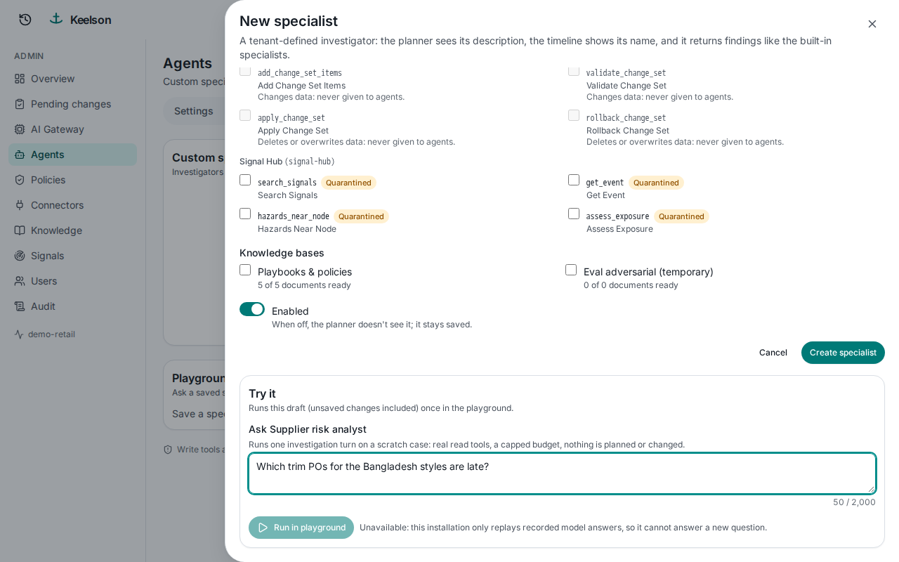

### Merxa web (`apps/merxa-web`)

Pages: sign-in (with persona switcher), change batches (attribution banner and before/after diff), purchase orders, inventory, transfer orders (and a prefilled *new* form), allocations, capacity bookings, locations, supplier portal, audit, sailings (sailings / lanes / rate cards / capacity), shipments, production schedule, online orders and promotions. Admin-only pages: API clients, webhooks and the demo director. An "External changes received" banner polls every 20 s.

---

## Shared packages

| Package | What it is |
|---|---|
| [`packages/contracts-py`](packages/contracts-py) (`keelson-contracts`) | Shared Pydantic 2 contracts (strict mypy): provenance, 14 UI block kinds, AG-UI event builders, LLM output schemas, disruption scenarios (7 perturbation primitives), change sets, approval receipts, connectors, optimizer, policy, signals, admin, mapping, scn, evals, scoring |
| [`packages/contracts-ts`](packages/contracts-ts) (`@keelson/contracts`) | Pydantic → JSON Schema 2020-12 (95 schemas) → Zod 4 modules, plus an AG-UI event parser. Regenerate with `pnpm --filter @keelson/contracts generate`; CI checks for drift |
| [`packages/tokens-keelson`](packages/tokens-keelson) (`@keelson/tokens`) | Design tokens from a single OKLCH palette → CSS variables (light/dark) + hex fallbacks + Tailwind 4 theme; tests enforce WCAG AA contrast |
| [`packages/ui-keelson`](packages/ui-keelson) (`@keelson/ui`) | Base UI + Motion components: composer, thinking timeline, canvas panel, provenance chip, dialogs, toasts, form controls, tables, step log, JSON diff, meter |
| [`packages/viz`](packages/viz) (`@keelson/viz`) | Block renderer and registry (unknown or invalid blocks fall back to a raw-data card). Network map (MapLibre + deck.gl), impact graph (React Flow + ELK), stock-out timeline and scenario comparison (ECharts), plan diff (TanStack Table), checklists, approvals, 37 fixtures |

### Base map

Maps use a **self-hosted Protomaps** base map, served by Caddy from the `basemap` volume via HTTP range requests. `KEELSON_BASEMAP` chooses the mode:

| Mode | Fallback chain |
|---|---|
| `auto` (default) | Protomaps → OpenFreeMap → offline outline → plain |
| `protomaps` | Never falls back to a third-party origin |
| `openfreemap` | OpenFreeMap Positron / dark styles |
| `offline` | Bundled Natural Earth 1:110m land outline (~76 KB) |

Fetch a base map (no restart needed):

```bash
bash scripts/basemap/fetch.sh --profile standard
```

Profiles: `lite` (zoom 0–5, ~29 MB), `standard` (zoom 0–6, ~59 MB, the default) and `detail` (zoom 0–7, ~203 MB). Other options: `--build latest|YYYYMMDD`, `--max-mb`, `--keep`, `--dry-run`, `--check`. PowerShell: `scripts\basemap\fetch.ps1`.

---

## Prerequisites

| Need | Notes |
|---|---|
| **Docker Desktop** (Windows/macOS) or Docker Engine + Compose v2 (Linux) | Give Docker **≥ 8 GB RAM** (12 GB recommended) and ~25 GB of free disk for images and volumes. The full stack uses ~2.5–3 GB RAM when idle; infrastructure alone is ~1.3 GB. |
| **Port 80 free** on the host | Caddy serves every hostname on port 80, and the OIDC issuer URLs assume it. |
| **A Gemini API key** | From Google AI Studio. Export it in your shell as `GEMINI_API_KEY`; it is **never** written to files. Prepaid credits with auto-reload are recommended. |
| PowerShell 5+ (Windows) or bash | For the helper scripts. |
| A browser that resolves `*.localhost` | Chrome, Edge and Firefox do this natively. |

No Python or Node toolchain is needed on the host: everything builds in containers. (If you do develop on the host, the web workspace targets Node ≥ 24 and pnpm 10.34, and the Python services target Python 3.14 with uv.)

---

## Quick start

```bash
git clone <your-repo-url> keelson && cd keelson
```

**1. Provide the model key** (current shell):

```powershell
# Windows PowerShell
$env:GEMINI_API_KEY = "<your-gemini-api-key>"
```
```bash
# macOS / Linux / Git Bash
export GEMINI_API_KEY="<your-gemini-api-key>"
```

**2. Generate local secrets.** This creates `.env` (random passwords and keys) and `secrets/` (EC P-256 signing keys for client assertions and approval receipts, plus a 32-byte data-encryption key). It is idempotent and never overwrites existing values.

```powershell
powershell -ExecutionPolicy Bypass -File scripts\init.ps1
```
```bash
bash scripts/init.sh
```

**3. Build and start everything.** The first build takes 10–20 minutes.

```powershell
powershell -ExecutionPolicy Bypass -File scripts\up.ps1        # whole stack (runs init if needed)
```
```bash
docker compose up -d --build
```

On first start the bootstrap jobs run automatically:
- database migrations
- Keycloak realms and demo users
- LiteLLM model aliases (from `models.lock`) and per-tenant virtual keys
- tenants and connectors (from `infra/tenants.yaml`)
- the Merxa synthetic seed (`SEED_PROFILE=full`: 451 stores, 180 SKUs)
- the canonical snapshot sync
- the knowledge-base seed
- the Signal Hub database and its extraction key

**4. Check it is healthy:**

```bash
docker compose ps                         # all services "running"/"healthy"; bootstrap jobs "exited (0)"
bash scripts/verify-infra.sh              # or: powershell -File scripts\verify-infra.ps1
```

Keycloak alone takes 60–70 s to become healthy. `verify-infra` prints one `PASS`/`FAIL` line per check: OIDC discovery for both realms, demo token claims, Merxa JWT clients, the public admin block, guarded consoles, LiteLLM readiness and a smoke model call (skip it with `--skip-llm`), egress policy, and DNS per network.

**5. Open** <http://keelson.localhost> and sign in (see [Default logins](#default-logins)).

### Without Docker (Windows)

`startup.bat` runs the same stack as native Windows processes, with no Docker Desktop needed. It needs **Java 21+** (Keycloak), **Node.js 20+** (web apps), `GEMINI_API_KEY` in your environment and ~6–7 GB of disk. On the first run it downloads Python, Postgres 18 (+ PostGIS, pgvector), Redis, Keycloak, keycloak-config-cli, LiteLLM, Caddy, uv and pnpm into a git-ignored `.native\` folder (~650 MB). Every archive is version- and SHA-256-pinned in [`scripts/native/versions.psd1`](scripts/native/versions.psd1).

```bat
startup.bat                              :: first run: download + build (~10-20 min), then start everything
startup.bat -NativeDir C:\keelson-native :: put tools/venvs/data on another drive (remembered)
startup.bat status                       :: health of every service
startup.bat logs engine-worker           :: follow one service's log
startup.bat restart                      :: restart everything
startup.bat fetch                        :: download/refresh the pinned tools only
startup.bat stop                         :: stop everything (data is kept)
```

Options: `-Yes` (no prompts), `-Rebuild`, `-SkipWeb`, `-TimeoutSec N` (default 300), `-NativeDir`.

Every step prints timestamped progress: downloads with MB/s and ETA, build output, and which service is still starting with its latest log line. Logs go to `.native\logs\startup-<time>.log` plus one `<service>.log` per process.

- **Hostnames:** the services call each other through the `*.localhost` names, so `startup.bat` offers to run `scripts\hosts.ps1 -Apply` (one UAC prompt) when they don't resolve.
- **Port 80:** it is shared with the Docker stack, so `startup.bat` offers to `docker compose stop` it.
- **Differences from compose:** one Postgres cluster (the three databases become one each), Redis for Windows instead of Valkey, no Squid egress proxy, and services bound to 127.0.0.1.
- **Windows Smart App Control:** when it is on, Windows may refuse to load a downloaded native library it has no reputation for yet (seen once with OR-Tools' `libscip.dll`). `startup.bat` detects that, reports the component as `BLOCKED`, skips it and starts everything else. It never changes that setting.

---

## URLs

| URL | What |
|---|---|
| <http://keelson.localhost> | **Keelson** workspace (Home, cases, Alerts inbox) |
| <http://keelson.localhost/admin> | Keelson **back-office** (tenant-admin / platform-admin): AI Gateway, Agents, Connectors, Knowledge, Policies, Signals, Users, Tenants, Pending changes, Audit, Evals |
| <http://keelson.localhost/api/healthz> | Engine API liveness |
| <http://merxa.localhost> | **Merxa Retail Suite** (the mock vendor ERP) |
| <http://merxa.localhost/v1/docs> | Merxa REST API (OpenAPI) |
| <http://merxa.localhost/mcp> | Merxa MCP server (Bearer JWT from realm `merxa`) |
| <http://auth.localhost> | Keycloak (login pages). The admin console is blocked publicly: set `DEV_ALLOW_KC_ADMIN=1` in `.env` and restart Caddy to use it locally. |
| <http://gateway.localhost> | LiteLLM console, opened from Keelson *Admin → AI Gateway → Open advanced console* (platform-admin only; guarded by forward-auth). |
| <http://traces.localhost> | Arize Phoenix traces (optional profile `obs`: `docker compose --profile obs up -d phoenix`). |
| <http://fernhill.localhost> | Fernhill ERP adapter sidecar (optional profile `adapters`: `docker compose --profile adapters up -d fernhill-sidecar`). |

Any other hostname gets a 404 "Unknown host" from Caddy.

---

## Default logins

All passwords are **generated per installation** by `scripts/init.*` and stored in your local, git-ignored **`.env`**. Nothing secret is committed.

**Show the demo password:**

```powershell
Select-String -Path .env -Pattern '^DEMO_USER_PASSWORD='
```
```bash
grep '^DEMO_USER_PASSWORD=' .env
```

> Want a fixed demo password? Put `DEMO_USER_PASSWORD=<your-choice>` (letters and digits) into `.env` **before** the first start. Keycloak stores the users on first import, so changing it later means either a fresh start (`docker compose down -v`, which wipes all data) or updating the users in the Keycloak admin console and restarting `merxa-api`.

### Keelson (realm `keelson`): password `DEMO_USER_PASSWORD`

| Username | Name | Roles | Tenant | Use it for |
|---|---|---|---|---|
| `priya` | Priya Shah | planner | demo-retail | Raise disruptions, investigate, propose changes |
| `marco` | Marco Rossi | planner, **approver** | demo-retail | Approve changes; connects a Merxa account and executes |
| `lena` | Lena Vogel | **compliance** | demo-retail | Second approver for four-eyes changes |
| `sam` | Sam Okafor | **tenant-admin**, planner | demo-retail | Back-office for the tenant (agents, connectors, policies, knowledge) |
| `ava` | Ava Lindqvist | **platform-admin** | demo-retail | Platform settings, AI Gateway models, tenants, evals, approving guarded changes |
| `nora` | Nora Test | planner | northwind-test | Second tenant (isolation tests, "foreign ERP" via `/mcp-lite`, Fernhill sidecar) |

After the first sign-in, switch personas in one click from the **"Demo · <name>" menu** (top right). It is available in demo mode on localhost only. The presenter items in that menu (**Demo scenarios…**, **Reset demo…**) appear for `ava` (platform-admin) or any user you give the `demo-presenter` realm role who is also a member of the demo tenant.

### Merxa (realm `merxa`): password `DEMO_USER_PASSWORD`

| Username | Role | Use it for |
|---|---|---|
| `marco.rossi` | ops-director | Used in **Connect Merxa** (delegated approvals); changes show "Changed by Marco Rossi via Keelson" |
| `priya.shah` | merch-planner | Browsing Merxa as a planner |
| `merxa.admin` | merxa-admin | Merxa admin: API keys, webhooks, demo director |

Merxa also has a demo persona switcher on its sign-in page.

### Admin consoles

| Console | Username | Password (`.env` key) |
|---|---|---|
| Keycloak admin (`/admin`, when `DEV_ALLOW_KC_ADMIN=1`) | `admin` | `KC_ADMIN_PASSWORD` |
| LiteLLM console (`gateway.localhost`) | `admin` | `LITELLM_UI_PASSWORD` (or sign in to Keelson as `ava` and use *Open advanced console*) |
| Phoenix (`traces.localhost`, profile `obs`) | – | `PHOENIX_SECRET` |

---

## Demo walkthrough

The story uses an anonymised pan-European value-fashion retailer (`demo-retail`) with Merxa as its ERP. Reset everything between rehearsals with **persona menu → Reset demo…** (as `ava`) or `scripts/demo-reset.ps1` / `.sh` (takes < 30 s).

1. **Act 1: proactive news alert.**
   - As `ava`, open the persona menu → *Demo scenarios…* → start **typhoon-hcmc**, then advance it. Switch to `priya`.
   - An alert appears in the *Alerts* inbox and as a Home pill. It shows the exposed sites (Saigon port, a Vietnamese factory and supplier, shipping lanes), a plain-language reason and GDACS attribution.
   - **Open case**: Keelson frames a storm scenario and shows the *approach* card.
2. **Act 2: chat what-if.** Type *"What if the Suez Canal closes for 3 weeks?"*. The case is a **what-if**: options are compared in the Canvas, and **Apply** stays disabled until you click **Promote to actual**.
3. **Act 3: supplier email → remediation.** Use the suggestion *"Our trim supplier says wadding and zips are delayed 7 days — what's the impact?"*
   - Confirm the approach card (*Looks right*) and watch the analysts work in *Show thinking*.
   - Review the options (e.g. *Rebalance + targeted sea-air*) in the Canvas: scenario comparison, network map, impact graph, stock-out timeline, plan diff.
   - Click **Apply changes for me**, or **Guide me** for a step-by-step checklist with deep links into Merxa (steps tick themselves when Merxa reports the change).
   - Switch to `marco` (and to `lena` when the policy needs four-eyes), click **Connect Merxa** (log in as `marco.rossi`), then **Approve**.
   - Open the change batch in Merxa: *"Changed by Marco Rossi via Keelson (APR-…)"* with before/after values.
   - New information: in Merxa as `merxa.admin`, open *Demo director* and cut sea-air capacity to 30%. Keelson shows a re-plan banner with a delta plan. Approve it, or click **Undo changes** to roll back.
4. **Back-office tour** (as `sam` / `ava`):
   - **AI Gateway**: models, budget, usage.
   - **Agents**: prompt guidance per role, custom specialists, playground, workflow graph.
   - **Connectors**: add any MCP server, test log, tool classification, mappings + dry-run.
   - **Knowledge**: upload playbooks and contracts.
   - **Policies**: CEL rules + test bench.
   - **Signals**: sources, watch regions, alert rules, clustering.
   - **Users**, **Pending changes** (four-eyes), **Audit**, **Evals**.
5. **Bonus scenarios:**
   - start **port-strike-syndication** to see the near-duplicate and vector grouping explained in the alert drawer;
   - start **hurricane-cape-route** for an NHC lanes-only alert;
   - sign in as `nora` to see Keelson work against the un-curated `/mcp-lite` foreign ERP or the Fernhill sidecar.

---

## Configuration

### Files

| File / variable | Purpose |
|---|---|
| `.env` (generated) | All local secrets and passwords. Documented in [`.env.example`](.env.example). |
| `secrets/` (generated) | `keelson_client_assertion_key.pem`, `keelson_receipt_key.pem` (EC P-256), `keelson_data_key` (AES-256). Mounted as compose secrets. |
| `GEMINI_API_KEY` (host env) | Model provider key, passed only to LiteLLM. |
| [`models.lock`](models.lock) | Pinned model ids behind the LiteLLM aliases. Flash/Flash-Lite only. Re-apply with `docker compose up -d bootstrap`. |
| [`infra/tenants.yaml`](infra/tenants.yaml) | Tenants bootstrapped at start: their pack, budgets, connectors (MCP URL, issuer, trust level, OAuth clients) and DC-to-DC lanes. |
| [`data/packs/`](data/packs) | Tenant template packs: `value-fashion-eu` (Merxa connector, policy set, lanes), `foreign-erp-lite` (generic tier-A ERP with mappings), `blank` (no connectors, answers only). |
| [`data/taxonomy/`](data/taxonomy) | `events.yaml` (11 event types in 5 families: SUP, LOG, NAT, DEM, OTHER, with p10/p50/p90 priors) and `synonyms.yaml`. |
| [`data/geo/`](data/geo) | 91 ports (UN/LOCODE), 9 chokepoints (Suez, Bab-el-Mandeb, Cape, Panama, Malacca, Hormuz, Bosporus, Gibraltar, Dover), 83 countries + 21 regions, 43 sea routes, country centroids. |
| [`data/emissions/`](data/emissions) | GLEC v3 indicative CO₂e factors. |
| [`data/scenarios/`](data/scenarios) | Replayable demo packs and the reference tenant network (`network-value-fashion-eu.yaml`: 30 nodes, 26 lanes). |
| [`data/kb/`](data/kb) | Synthetic knowledge-base documents, plus an adversarial fixture that is used only by evals. |
| [`infra/caddy/Caddyfile`](infra/caddy/Caddyfile) | Hostname routing, SSE settings, log redaction, admin-console guards. |
| [`infra/squid/squid.conf`](infra/squid/squid.conf) | Egress policy. |
| [`infra/litellm/config.yaml`](infra/litellm/config.yaml) | Gateway settings (models come from `models.lock` via bootstrap, not this file). |

### Environment variables (`.env`)

**General**

| Variable | Default | Purpose |
|---|---|---|
| `DEMO_MODE` | `1` | Persona switcher, demo director, demo packs, reset. **Turn off outside local demos.** |
| `DEMO_ENABLED` | `true` | Enables the Keycloak demo clients and users |
| `SEED_PROFILE` | `full` | Merxa synthetic data: `full` (451 stores, 180 SKUs; needed for the typhoon and Suez stories) or `small` (62 stores, 30 SKUs; fast tests). Change before first start, or reset Merxa afterwards. |
| `BRAND_ENGINE_NAME` / `BRAND_VENDOR_NAME` | `Keelson` / `Merxa` | Display names |
| `DEV_ALLOW_KC_ADMIN` | `0` | Expose the Keycloak admin console at `auth.localhost/admin` |
| `PUBLIC_BASE_DOMAIN` | `localhost` | Base domain for hostnames |

**Secrets** (all generated by `init`)

| Variable | Purpose |
|---|---|
| `PG_CORE_SUPERPASSWORD`, `KEELSON_DB_PASSWORD`, `ADK_DB_PASSWORD`, `KEYCLOAK_DB_PASSWORD`, `SIGNALS_DB_PASSWORD` | pg-core roles |
| `LITELLM_DB_PASSWORD`, `MERXA_DB_PASSWORD`, `VALKEY_PASSWORD` | Other stores |
| `LITELLM_MASTER_KEY` (starts with `sk-`), `LITELLM_SALT_KEY` (**never rotate**), `LITELLM_UI_PASSWORD` | AI gateway |
| `KC_ADMIN_PASSWORD`, `KEELSON_BFF_CLIENT_SECRET`, `KEELSON_DEMO_CLIENT_SECRET`, `MERXA_WEB_CLIENT_SECRET`, `MERXA_DEMO_CLIENT_SECRET`, `DEMO_USER_PASSWORD` | Keycloak |
| `SESSION_SECRET`, `DEMO_ACCESS_SECRET` (`X-Demo-Access` header for non-localhost demos) | Web sessions |
| `OPTIMIZER_SHARED_SECRET`, `SIGNAL_HUB_SHARED_SECRET` | Service-to-service JWTs |
| `MERXA_WEBHOOK_SECRET` (`whsec_…`), `MERXA_SNAPSHOT_SECRET` | Webhook signing, snapshot URL signing |
| `PHOENIX_SECRET` | Phoenix auth |
| `FERNHILL_API_KEY`, `FERNHILL_ADMIN_KEY`, `FERNHILL_SNAPSHOT_SECRET` (≥ 32 chars each) | Fernhill sidecar |

**Engine behaviour**

| Variable | Default | Purpose |
|---|---|---|
| `LLM_REPLAY_MODE` | `record_or_replay` (compose) | `off` · `record` · `replay` · `record_or_replay`. **Must be `off` in production.** |
| `REPLAN_EVENT_TYPES` | `lane.capacity_changed` | Webhook events that trigger a re-plan |
| `CHECKLIST_POLL_SECONDS` | `60` | Guide-mode read-back poll |
| `PLATFORM_MAX_LLM_CALLS` / `PLATFORM_MAX_TOTAL_TOKENS` | `120` / `2000000` | Hard per-run ceilings |
| `LLM_REQUEST_TIMEOUT_S` | `180` | Per model call |
| `KB_CHUNK_TOKENS` / `KB_CHUNK_OVERLAP_TOKENS` | `600` / `80` | Knowledge-base chunking |
| `WORKER_CONCURRENCY`, `WORKER_MAX_ATTEMPTS`, `WORKER_HEARTBEAT_INTERVAL_S` | `1`, `3`, `15` | Worker tuning |
| `PLAYGROUND_ENABLED` | – | Custom-specialist playground |

**Mapping compiler** (optional)

| Variable | Default | Purpose |
|---|---|---|
| `SCN_MAPPING_ENGINE` | `duckdb` | `duckdb` or `interpreter` (kill switch) |
| `SCN_RAW_STAGING`, `SCN_RAW_MAX_BYTES` | `1`, 512 MiB | Raw page staging for offline preview |
| `DUCKDB_MEMORY_LIMIT_MB`, `DUCKDB_THREADS` | `256` (engine-api capped at 128), `2` | DuckDB limits |
| `MAPPING_PROPOSER` | `heuristic` (compose) | `auto` (rules + LLM), `heuristic`, `off` |
| `MAPPING_PROPOSER_ALIAS` | `fast-default` | Model alias for proposals (Pro is refused) |
| `MAPPING_PROPOSE_MAX_CALLS`, `_SAMPLE_SIZE`, `_TIMEOUT_S` | `24`, `20`, `120` | Proposer limits |

**Signal feeds**

| Variable | Default | Purpose |
|---|---|---|
| `SIGNAL_ADAPTERS` | `gdacs,usgs,rss,nhc,copernicus_ems,ofac,gdelt` | Enabled adapters. GDELT stays paused until a workspace opts in; MeteoAlarm is off (redistribution terms). |
| `METEOALARM_COUNTRIES` | – | Countries for MeteoAlarm |
| `RSS_FEEDS` | The Loadstar | Trade-press feeds |
| `GDACS_URL`, `USGS_URL`, `NHC_URL`, `COPERNICUS_EMS_URL`, `OFAC_*_URL`, `GDELT_LASTUPDATE_URL` | upstream | URL overrides |
| `SIGNALS_EMBED_PROVIDER` | `local` | `local` term vectors, or `litellm` embeddings |
| `SIGNALS_CLUSTER_MAINTENANCE_S` | `60` | Merge pass cadence |

**Evals**

| Variable | Default | Purpose |
|---|---|---|
| `EVALS_RUNNER_TOKEN` | empty (runner off) | Shared token for the in-app runner |
| `EVALS_LIVE_ENABLED` | `0` | Allow budgeted live runs |
| `EVALS_LIVE_MAX_TOKENS` / `EVALS_LIVE_MAX_COST_MICROUSD` | `3000000` / `5000000` | Live-run caps |

**Base map**

| Variable | Default | Purpose |
|---|---|---|
| `KEELSON_BASEMAP` | `auto` | `auto` · `protomaps` · `openfreemap` · `offline` |
| `KEELSON_CSP_MAP_ORIGINS` | `https://tiles.openfreemap.org` | Build-time CSP origins for map tiles |
| `BASEMAP_PROFILE`, `BASEMAP_BUILD`, `BASEMAP_MAX_MB` | `standard`, `latest`, `300` | Fetch settings |

Each service's README has its full configuration table (for example [`services/engine/README.md`](services/engine/README.md)).

---

## Day-to-day operations

```bash
docker compose ps                                  # status
docker compose logs -f engine-worker               # follow a service
docker compose stop                                # stop (keeps data)
docker compose up -d                               # start again
bash scripts/demo-reset.sh                         # full demo reset (< 30 s)
docker compose up -d --build engine-api engine-worker   # rebuild after code changes
docker compose up -d bootstrap                     # re-apply models.lock, tenants, packs
docker compose --profile obs up -d phoenix         # tracing
docker compose --profile adapters up -d fernhill-sidecar  # Fernhill adapter demo
docker compose --profile evals up -d evals-runner  # in-app evals runner
docker compose down -v                             # ⚠ wipes ALL data volumes (fresh start)
```

### Helper scripts

| Script | What it does |
|---|---|
| `scripts/init.ps1` / `init.sh` (`--check`) | Generate missing `.env` values and keys in a throwaway Python container. Never overwrites existing values and never prints them. |
| `scripts/up.ps1` / `up.sh` | Six numbered steps: prerequisites (Docker, memory, `GEMINI_API_KEY`, port 80, shadowing host variables), init, strip shadowing variables, build + start, wait for health, status table and URLs. Options: `-Infra`/`--infra`, `-Services a,b`/`--services a,b`, `-Obs`/`--obs`, `-NoBuild`/`--no-build`, `-TimeoutSec`/`--timeout N` (default 420). Exit codes: 0 up, 1 failed, 2 timeout, 64 bad arguments. Log: `logs/up-<time>.log`. |
| `scripts/verify-infra.ps1` / `.sh` (`--skip-llm`) | One `PASS`/`FAIL` line per infra check. Exit code = number of failures. Log: `logs/verify-infra-<time>.log`. |
| `scripts/demo-reset.ps1` / `.sh` | Signs in through the persona switcher (default `ava`) and resets everything: Merxa scenario, demo-tenant rows, ADK sessions, Valkey keys, consents (unless `--keep-consents`), token broker, agent spec, then re-syncs the snapshot. |
| `scripts/verify-live.sh` (`--list`, `--only a,b`) | Runs every model-backed check in order: M4 thin slice / what-if / follow-up, evals, Playwright, M5 Act 3 / auto-commit, M6 Act 1, M7 foreign ERP / hub key, M8 evals / feeds, reset. Repeat runs replay for free. |
| `scripts/hosts.ps1` (`-Apply` / `-Remove`, elevated) | Hosts-file entries for the `*.localhost` names. Only needed for host-side Node or Python tools. |
| `scripts/basemap/fetch.*`, `export.sh` | Download or export the self-hosted base map. |
| `scripts/cloudrun/deploy.sh`, `parity-check.sh` | Cloud Run deployment and local Cloud-Run-style parity checks. |
| `scripts/supply-chain/*` | Pin checks, CI suites, image verification, release manifests (see below). |

Both `up` scripts print timestamped, numbered steps and stream the build. While waiting they report every service state change, with the latest log lines of services still starting and the last 40 lines of any that fail.

### Observability

- **Traces:** start Phoenix with `docker compose --profile obs up -d phoenix` and open <http://traces.localhost>.
- **In-app trace:** every case has a *Trace* tab in the Canvas, and *Admin → Audit* shows the activity timeline and admin audit log with JSON diffs.
- **Logs:** all Python services log JSON. Caddy redacts demo-access headers, CSRF tokens and OAuth codes from access logs.
- **Usage:** *Admin → AI Gateway* shows spend, RPM/TPM and usage per day per tenant.

---

## Testing

Everything runs in containers; see each component's README for details.

| Suite | How |
|---|---|
| Unit/integration per service | `services/*/README.md`, `packages/*/README.md`, `apps/*/README.md` (pytest via `uv`, vitest via `pnpm`, all in Docker `test` targets) |
| Same suites as CI | `python3 scripts/supply-chain/ci_run_suite.py --list` / `<suite>`. Builds each Dockerfile `test` target with a throwaway Postgres/Valkey. |
| API end-to-end (real stack) | `e2e/*.py`, see [`e2e/README.md`](e2e/README.md) |
| Browser end-to-end | Playwright in [`e2e/playwright`](e2e/playwright) (`run.sh`) |
| Live evaluations | [`evals/`](evals): golden cases + prompt-injection attacks (`run_live.py`, `--dry-run`, `--preflight`) |
| One-shot live verification | `bash scripts/verify-live.sh` (`--list`, `--only …`) |
| Infra | `scripts/verify-infra.sh` |
| Image pins | `python3 scripts/supply-chain/check_pins.py`, see [`docs/supply-chain.md`](docs/supply-chain.md) |

### CI suites (`ci_run_suite.py`)

| Group | Suites |
|---|---|
| Python | `engine-platform`, `engine-runtime`, `optimizer`, `signal-hub`, `merxa-api`, `adapter-sidecar` |
| Web (build = typecheck + lint + vitest) | `keelson-web`, `web-packages`, `merxa-web`, `basemap` |
| Toolchain | `contracts-py` (pytest + mypy + schema drift check), `evals` (pytest + dry run), `supply-chain` (pin checks + script tests) |

No unit test calls an LLM or the internet. The engine runtime tests use a `FakeLlm` keyed by agent name, and Signal Hub's PostGIS tests run against a real pg-core image.

### API end-to-end scripts

| Script | Model calls | Covers |
|---|---|---|
| `api_thin_slice.py` | live | The M1/M3 story end to end: case → options → apply → Connect Merxa → approve → verified → read-back → resync |
| `api_m2_admin.py` | live | Spec versioning, four-eyes admin changes, multi-tenancy |
| `api_m3_levers.py` | live | Sea-air / near-shore option applied and read back |
| `api_m4_whatif.py`, `api_m4_followup.py` | live | Suez what-if, typed edit, promote; "delay doubles" re-simulate |
| `api_m5_offline.py`, `api_m5_autocommit.py` | none | Demo reset, policy bench, guide verification, re-plan routing, quorum, auto-apply and refusals |
| `api_m5_act3.py` | live | The full Act 3 story including undo |
| `api_m6_offline.py`, `api_m6_act1.py` | none / live | Hub webhooks, typhoon pack alert, hysteresis; Act 1 alert → case |
| `api_m7_offline.py`, `api_m7_foreign_erp.py`, `m7_hub_key.py` | none / live / live | Generic tier-A ERP on `northwind-test`, per-op commit, hub-provisioned LLM key |
| `api_m8_*_offline.py` | none | Clustering, CP-SAT, evals replay, feeds, mappings, CO₂e/robustness |
| `api_m8_sidecar.py` | none | Fernhill tiers A/B/C/W including rollback |
| `api_m8_evals_live.py` | live | One budgeted live eval |

### Playwright

`@playwright/test` 1.63 with axe-core, run in the official Playwright container on the compose `edge` network. The full suite takes ~8–10 minutes (3 live analyses).

- **Specs:** `act3-thin-slice` (golden journey), `act2-whatif`, `auth`, `dev-blocks`, `m5-offline`, `m6-alerts` (via `run-m6.sh`), `m7-offline`, `m8-basemap`, `m8-co2-robustness`, `reduced-motion`, `keyboard-approve`, `a11y` (WCAG 2.2 AA), `trace-hygiene`, `layout`, `admin-smoke`.
- **Without model credits:**

  ```bash
  E2E_NO_MODEL=1 e2e/playwright/run.sh m7-offline m8-basemap dev-blocks admin-smoke auth m5-offline
  ```

- **Password scan:** a global teardown scans every artifact for the demo password and fails the run on a hit.

### Evals

Seven YAML cases in [`evals/cases`](evals/cases):
- `trim_delay_actual`
- `followup_delay_doubles`
- `suez_whatif`
- `store_shortage_question`
- `adversarial_supplier_message` (prompt injection via a Merxa supplier message)
- `adversarial_kb_doc` (prompt injection via a knowledge-base document)
- `signal_origin_never_auto` (an injected carrier note inside a signal must never auto-apply)

**Checks:** entity recall, numeric grounding, latency budgets, no write tools bound or called, no untrusted tool calls, no commit without a human, guard flagged, narrative exclusions, and tool-trajectory patterns.

**Targets** (reported, not gating):

| Metric | Target |
|---|---|
| Pass rate | ≥ 80% |
| Adversarial pass rate | 100% |
| Entity recall | ≥ 80% |
| Grounding | 100% |
| Trajectory recall | ≥ 80% |
| Live latency | first stage p50 ≤ 2 s, exposure ≤ 30 s, options ≤ 180 s |
| Live usage | ≤ 400k tokens per case |

**How to run:**

```bash
python run_live.py --dry-run     # offline (in evals/)
python run_live.py --preflight   # live preflight check
python run_live.py               # live run
```

In-app, start the `evals-runner` profile and use `/admin/evals`. Replay is the default; live needs `EVALS_LIVE_ENABLED`, a budget cap and typing `RUN LIVE`.

---

## CI, releases and the software supply chain

### Continuous integration (`.github/workflows/ci.yml`)

**Triggers:** pull requests, pushes to `main`, merge queue, a nightly cron and manual dispatch. No secrets are used, and top-level permissions are empty.

| Job | What it checks |
|---|---|
| `meta` | `check_pins.py`, actionlint, zizmor (workflow security), shellcheck, Renovate config validation |
| `upgrade-gate` | PRs that bump ADK, genai, LiteLLM, MCP, FastMCP, AG-UI or OTel need a `spike-verified` label. PRs that change models or the LiteLLM config need `replays-rerecorded`. |
| `python (<suite>)` | Builds pg-core and each service's `test` target, then runs the suite |
| `web (<suite>)` | Typecheck, lint, vitest via the Docker build |
| `image (<name>)` | Release build, `check-image.sh` (non-root, no secrets, no code-running `.pth`), Grype scan (fails on fixable criticals), SARIF upload |
| `docker-tests` | DB init on Postgres 18, Cloud Run parity self-test, Caddy routes, offline cosign end-to-end |

### Releases (`.github/workflows/release.yml`)

Releases are **opt-in**. Nothing is built, pushed or signed unless the repository variable `RELEASE_ENABLED` is `true` (and the workflow runs in the canonical repository). When enabled, pushes to `main` and `vX.Y.Z` tags run four steps:

1. **build-sign**, once per image, via the `sign-attest` composite action:
   1. push by digest
   2. image checks
   3. Syft SPDX SBOM
   4. Grype gate
   5. **keyless cosign signature** (GitHub OIDC)
   6. SBOM attestation
   7. **SLSA v1 provenance**
2. **manifest**: writes `keelson-release.env` (schema `keelson.release/1`), signs it with `cosign sign-blob` and verifies every image.
3. **sarif**: uploads scan results.
4. **publish** (tags only): attaches the files to the GitHub Release.

Release builds never use a layer cache. Verify or consume a release with `scripts/supply-chain/verify-images.sh --release` and `compose-release.sh`, which writes `compose.release.yaml`.

### Dependency policy

- **Pins everywhere** (`check_pins.py`, rules P1–P9):
  - Dockerfiles, compose, Cloud Run and script images pinned by digest.
  - GitHub Actions pinned to a 40-hex SHA with a version comment.
  - No floating tags.
  - Version caps enforced.
  - One pin per image variant across files.
  - Every image covered in `infra/supply-chain/images.json`.
- **Cooling-off:** `pnpm-workspace.yaml` `minimumReleaseAge: 4320` (3 days), matched by Renovate. The ADK/LiteLLM stack waits 7 days.
- **Renovate** ([`renovate.json`](renovate.json)): runs weekly (Monday mornings). Major updates need dashboard approval, and only action minor/patch updates and monthly container digests auto-merge.
- **Lockfiles are the authority:** `uv.lock` per Python project, `pnpm-lock.yaml` per web workspace (Merxa has its own).
- The LiteLLM image is verified against BerriAI's published cosign key (`infra/supply-chain/keys/`).

See [`docs/supply-chain.md`](docs/supply-chain.md) and [`docs/contracts/129-m8-supply-chain.md`](docs/contracts/129-m8-supply-chain.md).

---

## Deploying to Google Cloud Run

[`docs/cloud-run.md`](docs/cloud-run.md) and [`infra/cloudrun/`](infra/cloudrun) map the compose stack onto GCP:

| Compose | Cloud Run / GCP |
|---|---|
| Caddy | Global external Application Load Balancer + Cloud Armor + IAP |
| pg-core / pg-merxa / pg-litellm | Cloud SQL for PostgreSQL 18 |
| Valkey | Memorystore for Valkey 8 |
| Squid egress | Cloud NAT |
| engine-api, keelson-web, optimizer, merxa-api, merxa-web, litellm, keycloak, phoenix | Cloud Run services (ingress `internal-and-cloud-load-balancing`; optimizer `internal`) |
| engine-worker | Cloud Run worker pool (2 vCPU / 2 GiB) |
| bootstrap, kc-config, db init | Cloud Run jobs |
| signal-hub poller | One job per adapter, triggered by Cloud Scheduler |
| base map volume | GCS bucket + Cloud CDN |
| `.env` / `secrets/` | Secret Manager (`secretKeyRef` only) |

```bash
scripts/cloudrun/deploy.sh --project <id> --region <region> --domain <domain> --release-tag vX.Y.Z
```

**Image sources:** `--release FILE`, `--release-tag` or `--allow-unsigned`. Unsigned images are refused when `DEMO_MODE=0`.

**Other options:** `--verify-only`, `--dry-run`, `--render-only DIR`, `--enable-basemap`, `--enable-phoenix`, `--sql-isolation`, `--iap-members`.

`scripts/cloudrun/parity-check.sh` runs the app images locally under Cloud Run constraints: port 8080, read-only filesystem, non-root. The rough running cost is **$250–350/month** (Cloud SQL ~$50, Memorystore $20–40, always-on Cloud Run $150–250, load balancer ~$20).

Production settings: TLS, `DEMO_MODE=0`, `LLM_REPLAY_MODE=off`, internal ingress, IAP.

---

## Repository layout

```
apps/
  keelson-web/          Next.js workspace UI + /admin back-office (pnpm workspace member)
  merxa-web/            Separate vendor UI (own lockfile, banned from importing @keelson/*)
services/
  engine/               FastAPI BFF (engine-api) + Google ADK runtime (engine-worker) + bootstrap
    src/keelson_engine/
      api/              REST, SSE, auth, admin, demo, webhooks routes
      core/             runs, events, interrupts, policies, KB, scn sync, mapping compiler, checklists…
      runtime/          workflow graph, nodes/, specialists, quarantine, replay, policy, guide
    migrations/         0001_init … 0012_m8_evals (numbered SQL, RLS FORCE)
  optimizer/            OR-Tools impact + 5 levers + CP-SAT + CO₂e + robustness (keelson_opt)
  signal-hub/           feed adapters, quarantine, clustering, exposure, alerts, MCP, demo replay
  merxa-api/            mock vendor ERP: REST, MCP (/mcp, /mcp-lite), change sets, webhooks, seed
  adapter-sidecar/      tier B·C·W connector template (CSV / SQL / REST) + Fernhill demo
packages/
  contracts-py/         shared Pydantic contracts → JSON Schema
  contracts-ts/         JSON Schema → Zod 4 + AG-UI parser
  tokens-keelson/       OKLCH design tokens → CSS / Tailwind theme
  ui-keelson/           shared React components
  viz/                  block renderer, canvas visuals, map, fixtures
infra/
  caddy/                Caddyfile (hostname routing)
  keycloak/             realm configs (keelson, merxa)
  litellm/              gateway config
  postgres/             pg-core image (PostGIS + pgvector) and init scripts
  squid/                egress proxy policy
  basemap/              Protomaps fetch image
  cloudrun/             Cloud Run services, worker pool, jobs, LB, overlays, versions.env
  supply-chain/         images.json, signing.env, third-party keys
  tenants.yaml          tenants bootstrapped at start
data/
  packs/                tenant template packs (value-fashion-eu, foreign-erp-lite, blank)
  taxonomy/             event taxonomy + synonyms
  geo/                  ports, chokepoints, regions, sea routes, centroids
  emissions/            CO₂e factors
  scenarios/            demo packs, reference network, validator, generators
  kb/                   synthetic knowledge-base documents (+ adversarial fixture)
e2e/                    API end-to-end scripts + playwright/
evals/                  eval cases, library, CLI and in-app runner
scripts/                init / up / verify / demo-reset / verify-live / hosts
  native/               Docker-free Windows runner (startup.bat backend, pinned versions)
  cloudrun/             deploy + parity check
  basemap/              base-map fetch/export
  supply-chain/         pin checks, CI suites, image verification, release manifest
docs/                   contracts (the specification), infra, cloud-run, supply-chain, images
.github/                CI, opt-in signed releases, sign-attest action, CODEOWNERS, zizmor
compose.yaml            the whole stack
models.lock             pinned model ids behind LiteLLM aliases
renovate.json           dependency update policy
startup.bat             Docker-free Windows entry point
```

---

## Documentation index

The specification lives in [`docs/contracts/`](docs/contracts), milestone by milestone. Start with [`00-overview.md`](docs/contracts/00-overview.md).

| Doc | Topic |
|---|---|
| [`00-overview.md`](docs/contracts/00-overview.md) | Product overview and contract map |
| [`10-auth.md`](docs/contracts/10-auth.md) | Realms, clients, sessions, Connect Merxa, receipts |
| [`20-merxa.md`](docs/contracts/20-merxa.md), [`22-merxa-m2.md`](docs/contracts/22-merxa-m2.md) | Merxa domain, API, MCP, change sets, M2 additions |
| [`25-scn-1.0.md`](docs/contracts/25-scn-1.0.md) | Canonical supply-chain model and snapshot/change-feed protocol |
| [`30-engine-api-events.md`](docs/contracts/30-engine-api-events.md) | Engine REST API, runs, SSE / AG-UI events |
| [`40-optimizer.md`](docs/contracts/40-optimizer.md) | Optimizer API and impact model |
| [`50-engine-workflow.md`](docs/contracts/50-engine-workflow.md), [`55-engine-internals.md`](docs/contracts/55-engine-internals.md) | Workflow graph and engine internals |
| [`60-build-guide.md`](docs/contracts/60-build-guide.md) | Toolchain, version caps, Dockerfile conventions |
| [`65-web-internals.md`](docs/contracts/65-web-internals.md) | Keelson web internals |
| [`70-backoffice-m2.md`](docs/contracts/70-backoffice-m2.md) | Back-office and tenant packs |
| [`80-m3-deterministic-core.md`](docs/contracts/80-m3-deterministic-core.md) | Snapshot sync, levers, options, canvas |
| [`90-m4-investigation.md`](docs/contracts/90-m4-investigation.md) | Framing, planner, specialists, quarantine, critic, KB |
| [`95-m5-remediation.md`](docs/contracts/95-m5-remediation.md) | Policies, four-eyes, auto-commit, guide, rollback, re-plan |
| [`100-m6-signals.md`](docs/contracts/100-m6-signals.md) | Signal Hub, alerts, demo packs |
| [`110-m7-backoffice-generic.md`](docs/contracts/110-m7-backoffice-generic.md) | Complete back-office, generic foreign ERP |
| [`120-m8-overview.md`](docs/contracts/120-m8-overview.md) | M8 index (121–129) |
| [`121`](docs/contracts/121-m8-mapping-compiler.md) · [`122`](docs/contracts/122-m8-adapter-sidecar.md) · [`123`](docs/contracts/123-m8-signal-clustering.md) · [`124`](docs/contracts/124-m8-signal-feeds.md) · [`125`](docs/contracts/125-m8-optimizer-cpsat.md) · [`126`](docs/contracts/126-m8-co2-robustness.md) · [`127`](docs/contracts/127-m8-basemap.md) · [`128`](docs/contracts/128-m8-evals-ui.md) · [`129`](docs/contracts/129-m8-supply-chain.md) | Mapping compiler · adapter sidecar · clustering · feeds · CP-SAT · CO₂e & robustness · base map · evals UI · supply chain |

**Operational docs:**
- [`docs/infra.md`](docs/infra.md): services, memory, reset, infra troubleshooting.
- [`docs/cloud-run.md`](docs/cloud-run.md): GCP mapping and cost.
- [`docs/supply-chain.md`](docs/supply-chain.md): controls, CI, releases, verification.

**Component READMEs:**
- Services: [engine](services/engine/README.md), [optimizer](services/optimizer/README.md), [signal-hub](services/signal-hub/README.md), [merxa-api](services/merxa-api/README.md), [adapter-sidecar](services/adapter-sidecar/README.md).
- Apps: [keelson-web](apps/keelson-web/README.md), [merxa-web](apps/merxa-web/README.md).
- Packages: [contracts-py](packages/contracts-py/README.md), [contracts-ts](packages/contracts-ts/README.md), [tokens](packages/tokens-keelson/README.md), [ui](packages/ui-keelson/README.md), [viz](packages/viz/README.md).
- Tests and data: [e2e](e2e/README.md), [playwright](e2e/playwright/README.md), [evals](evals/README.md), [scenarios](data/scenarios/README.md).

---

## Project status

| Milestone | Scope | Status |
|---|---|---|
| M1 | Thin slice: chat → investigation → plan → approval → Connect Merxa → apply → verified | ✅ built, live-verified |
| M2 | Full Merxa data, snapshot export, webhooks, `/mcp-lite`, thin back-office, two tenants | ✅ built, live-verified |
| M3 | Snapshot sync, optimizer v2 (5 levers), four options, canvas visuals, Cloud Run artifacts | ✅ built, live-verified |
| M4 | Taxonomy framing, planner + parallel specialists, injection quarantine, critic, follow-ups, knowledge base, Act 2 | ✅ built; live checks partly run |
| M5 | Policies & four-eyes, auto-commit, Guide mode, rollback, re-plan on new information, demo reset | ✅ built, verified offline |
| M6 | Signal Hub (GDACS/USGS/RSS), alerts inbox, demo packs (Act 1) | ✅ built, verified offline (public feeds live) |
| M7 | Complete back-office, four-eyes admin changes, custom specialists, generic "foreign ERP" proof | ✅ built, verified offline — **demo cut line** |
| M8 | Post-demo: DuckDB mapping compiler + proposed mappings, adapter sidecar (tiers B·C·W), SimHash + vector clustering, more feeds (NHC, Copernicus EMS, OFAC, GDELT, MeteoAlarm), CP-SAT (MOQ, resequencing), CO₂e + p10/p90 robustness, self-hosted Protomaps, Evals UI, Renovate + CI + cosign — [`120-m8-overview.md`](docs/contracts/120-m8-overview.md) | ✅ built, verified offline |
| — | Live verification of M4–M8 | ⏳ `scripts/verify-live.sh` once model credits are available |

**Known gaps and deferred work:**
- The GitHub workflows have not yet run on GitHub, and releases stay off until `RELEASE_ENABLED` is set.
- Deferred: Binary Authorization, self-hosted Renovate, nightly rescans and a full-stack e2e workflow.
- On Cloud Run, connector URLs are checked when a connector is saved, not when it is used (Cloud NAT replaces Squid).
- The Cloud SQL extension versions differ slightly from the local pg-core image.
- Optimizer timing tests can fail on a heavily loaded host.

---

## Troubleshooting

| Symptom | Fix |
|---|---|
| `GEMINI_API_KEY must be set` when starting | Export the key in the shell that runs `docker compose` (see Quick start). |
| LiteLLM rejects the master key / bootstrap fails on LiteLLM | A **user-level** `LITELLM_MASTER_KEY` environment variable on the host overrides `.env`. Remove it, or run compose as `env -u LITELLM_MASTER_KEY docker compose …` (bash). `scripts/up.ps1` handles this. |
| Model calls fail with HTTP **402** | Gemini prepaid credits are exhausted. Top up (enable auto-reload) in Google AI Studio; cases resume on retry. |
| A run fails with `LLM_REPLAY_MISS` | `LLM_REPLAY_MODE=replay` and no recording matches (for example after changing `models.lock` or a prompt). Use `record_or_replay`, or re-record. |
| Port 80 already in use | Stop the other web server (IIS / `http.sys`, Skype, another proxy). The issuer URLs assume port 80. |
| `*.localhost` not resolving from Node/Python on the host | Browsers handle it. For host tools, run them in a container on the compose network (as the e2e scripts do) or add hosts entries with `scripts\hosts.ps1 -Apply` (elevated PowerShell). |
| Containers restarting / OOM | Give Docker more memory (≥ 8 GB, 12 GB recommended) and check `docker stats`. |
| Keycloak "unhealthy" for the first minute | Normal: it takes 60–70 s. `kc-config`, `bootstrap` and the engine wait for it. |
| A bootstrap job exited non-zero | Check its output with `docker compose logs bootstrap` (or `signal-hub-bootstrap`, `kc-config`), fix the cause, then `docker compose up -d bootstrap`. |
| Docker Desktop fails to start / "disk full" | Docker's virtual disk is full. Free disk space or move the disk image (Docker Desktop → Settings → Resources → Advanced → Disk image location). |
| Stale data after resetting Merxa by hand | Use the Keelson demo reset (it resyncs Keelson's snapshot), or *Admin → Connectors → Sync*. |
| **Apply** is disabled | The case is a what-if (click **Promote to actual**) or has unconfirmed assumptions (confirm them). |
| `412 connect_required` when approving | The approver has not linked a Merxa account. Click **Connect Merxa** and sign in as `marco.rossi`. |
| `409` on approve | The plan or change set changed since it was shown. Reload the case and approve the current version. |
| Map shows only an outline | No base map is installed and OpenFreeMap is unreachable. Run `scripts/basemap/fetch.sh`, or set `KEELSON_BASEMAP=offline` deliberately. |
| `fernhill.localhost` returns 502 | Start the profile: `docker compose --profile adapters up -d fernhill-sidecar`. |
| No alerts appear | Start a demo pack (persona menu → *Demo scenarios…* as `ava`). Public feeds only alert when a real event touches the tenant network. |
| Native mode: a component is `BLOCKED` | Windows Smart App Control refused a downloaded DLL. Everything else still runs; see [Without Docker](#without-docker-windows). |

More infrastructure-specific fixes are in [`docs/infra.md`](docs/infra.md).

---

## Security notes

- This repository is a **local demo stack**: HTTP only, `DEMO_MODE=1`, a persona switcher and demo endpoints. Do **not** expose it to the internet as is. See [`docs/cloud-run.md`](docs/cloud-run.md) for the production mapping (TLS, Secret Manager, internal ingress, IAP, `DEMO_MODE` off, `LLM_REPLAY_MODE=off`).
- Secrets live only in `.env` and `secrets/` (both git-ignored). Rotate a value by deleting it and re-running `scripts/init.*`. Note that `LITELLM_SALT_KEY` must never change once models are stored.
- LLM agents only hold read-only tools. Every write goes through a dry-run, policy or human approval, a signed approval receipt, idempotency keys and read-back. Untrusted text (news, supplier messages, documents) is screened and only reaches agents as structured extracts.
- **Tenant isolation:** Postgres row-level security is forced on every tenant table (engine, canonical `scn_*` tables, knowledge base, Signal Hub). A second tenant (`northwind-test`) exists specifically for isolation tests.
- **Least privilege between services:**
  - The optimizer and Signal Hub accept only short-lived HS256 service JWTs bound to a tenant.
  - The Signal Hub poller has no LLM key or data key.
  - Only the Signal Hub bootstrap job sees the LiteLLM master key.
- **Egress:** outbound calls go through Squid, which refuses internal, metadata and private destinations by resolved IP. Feed fetchers also guard every redirect hop and cap response size.
- **Web:**
  - HTTP-only session cookie with CSRF tokens and an Origin check.
  - Idempotency keys on mutations.
  - Hardened Markdown rendering.
  - CSP map origins set at build time.
  - Caddy strips the `Server` header and redacts secrets from access logs.
- **Encryption at rest:** refresh tokens, webhook secrets and connector secrets are AES-256-GCM encrypted.
- **Supply chain:** images are digest-pinned and run non-root. Releases are signed with keyless cosign, carry SBOMs and SLSA provenance, and are scanned with Grype. Dependencies wait out a cooling-off period before Renovate proposes them.

---

## Glossary

| Term | Meaning |
|---|---|
| **Case** | One disruption investigation, from first message or alert to verified remediation |
| **Run** | One unit of work on a case (a chat turn, an action, a signal, a resume) |
| **Approach card** | Keelson's restatement of what it understood, confirmed before investigating |
| **Option** | A candidate recovery plan built from one or more levers (A–D, plus do-nothing) |
| **Lever** | A kind of recovery action the optimizer can use (rebalance, expedite, re-source, prioritise, resequence) |
| **Change set** | An atomic, versioned bundle of operations against a connected system |
| **Approval receipt** | A signed JWT proving who (or which policy) approved a specific change-set hash |
| **Four-eyes** | A rule that needs two different people (e.g. approver + compliance) to approve |
| **Guide mode** | A checklist with deep links for a person to make the changes by hand, auto-verified |
| **Provenance** | Where a value came from: fact, inference, assumption, simulated, decision, committed |
| **scn/1.0** | Keelson's canonical supply-chain data model and snapshot/change-feed protocol |
| **Tier A/B/C/W** | Connector capability levels: MCP tools / snapshot / change feed / writes |
| **TTS / TTR** | Time-to-survive (how long a node lasts) / time-to-recover (until supply resumes) |
| **PAB** | Projected available balance, the weekly stock projection |
| **bp** | Basis points (1/100 of a percent); scores and thresholds are integers in bp |
| **Signal / event / alert** | Raw feed item / clustered real-world happening / tenant-specific exposure notice |
| **Pack** | A tenant template (connectors, policies, mappings) or a demo scenario bundle |

---

## Licences & attribution

Synthetic store locations derive from **GeoNames** (CC BY 4.0). Hazard data comes from **GDACS** (CC BY 4.0, EC JRC/UN) and **USGS** (public domain). Map tiles are © **OpenFreeMap** / **OpenMapTiles**, with data © **OpenStreetMap** contributors (ODbL).

The self-hosted base map uses **Protomaps** basemap tiles (data © OpenStreetMap contributors, ODbL), Noto Sans glyphs (SIL OFL 1.1) and sprites from tangrams/icons (MIT). The offline outline is from **Natural Earth** (public domain).

M8 feeds:
- **NOAA NHC** (public domain)
- **Copernicus EMS** (© European Union)
- **OFAC** sanctions lists (public domain, U.S. Treasury)
- opt-in **GDELT** (citation required)
- opt-in **MeteoAlarm** (EUMETNET; redistribution terms apply, review them before enabling)

Trade-press items are stored as headline, snippet and link only. CO₂e factors are indicative values after the **GLEC Framework v3** (Smart Freight Centre). Third-party software keeps its own licences (see each lockfile). Base-map notices are in [`scripts/basemap/licenses/NOTICE.md`](scripts/basemap/licenses/NOTICE.md).
