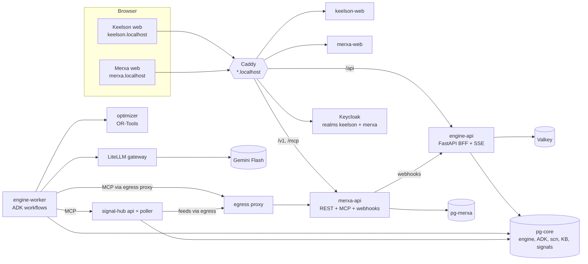

# Keelson — AI-powered supply-chain disruption planning & recovery

**Keelson** is a generic, agentic engine that **senses**, **investigates**, **plans** and **remediates** supply-chain disruptions — whether they arrive from **news & hazard feeds**, **events in connected systems**, a **supplier email**, or a planner's **chat question** ("a typhoon is heading for Ho Chi Minh City — what's our exposure?", "what if the Suez Canal closes for 3 weeks?").

It ships with **Merxa Retail Suite**, a deliberately separate *mock third-party ERP* (SKUs, POs, inventory, shipping, stores…) that Keelson connects to **only through MCP / REST / webhooks** — so the demo proves the AI can produce a remediation plan, **guide** a user through manual steps, and **bulk-remediate** someone else's system with approvals and a full audit trail.

> All data is synthetic. "Keelson" and "Merxa" are fictional brands; the client is anonymised.

| Calm workspace | Result canvas | Change landing in the vendor's system |
|---|---|---|
|  |  |  |
|  |  |  |

---

## Contents
1. [What's inside](#whats-inside)
2. [Architecture](#architecture)
3. [Prerequisites](#prerequisites)
4. [Quick start](#quick-start)
5. [URLs](#urls)
6. [Default logins](#default-logins)
7. [Demo walkthrough](#demo-walkthrough)
8. [Configuration](#configuration)
9. [Day-to-day operations](#day-to-day-operations)
10. [Testing](#testing)
11. [Repository layout](#repository-layout)
12. [Project status](#project-status)
13. [Troubleshooting](#troubleshooting)
14. [Security notes](#security-notes)
15. [Licences & attribution](#licences--attribution)

---

## What's inside

| Part | What it does |
|---|---|
| **Keelson web** (Next.js 16) | Gemini-style calm UI: one composer, a live *thinking* timeline (which agents are consulted, plain-language activity), an "approach" card to confirm what was understood, recommendation cards, and a side **Canvas** with the rich visuals (network map, impact graph, stock-out timeline, option comparison, plan diff). Alerts inbox. Role-gated **back-office** (`/admin`). |
| **Keelson engine** (Python, FastAPI + Google ADK 2.11) | Graph workflow: intake → taxonomy-driven framing → planner → parallel specialists (sourcing, logistics, inventory & demand, playbook, external intelligence, tenant custom specialists) → verify numbers → critic → deterministic impact & optimisation → recommendation → approvals (policy rules, four-eyes, capped auto-commit) → apply via MCP → read-back → re-plan on new information → rollback. LLMs never invent numbers and never hold write tools. |
| **Optimizer** (OR-Tools) | Deterministic impact analysis (first stock-out dates, time-to-survive) and five recovery levers: rebalance between DCs, sea-air expedite, near-shore re-source, allocation prioritisation, factory resequencing. |
| **Signal Hub** | Polls GDACS, USGS and trade-press RSS (plus connector events), clusters them, matches exposure against each client's network and raises alerts. Replayable demo packs (typhoon, trim delay, Suez). |
| **LiteLLM** | Single gateway for every chat and embedding model (Gemini by default — **Flash/Flash-Lite only**), with per-tenant keys, budgets and usage; managed from Keelson's *AI Gateway* admin page. |
| **Keycloak** | Two identity worlds: realm `keelson` (our product) and realm `merxa` (the vendor). OAuth/MCP between them, delegated approver identity for writes. |
| **Merxa Retail Suite** (FastAPI + Next.js) | The mock vendor ERP with its own database, realm and design system; REST, an MCP server (`/mcp`), a plain "foreign ERP" MCP profile (`/mcp-lite`), change-sets with dry-run/apply/rollback, signed webhooks, Parquet snapshot export, prefilled forms for guided steps, a demo director. |

---

## Architecture



Design principles: *AI investigates and explains; deterministic services compute, validate and commit.* Every value carries provenance (fact · inference · assumption · simulated · decision · committed). See [`docs/contracts/`](docs/contracts) for the full specification and the product plan referenced there.

---

## Prerequisites

| Need | Notes |
|---|---|
| **Docker Desktop** (Windows/macOS) or Docker Engine + Compose v2 (Linux) | Give Docker **≥ 8 GB RAM** (12 GB recommended) and ~25 GB free disk for images/volumes. The full stack uses ~2.5–3 GB RAM when idle. |
| **Port 80 free** on the host | Caddy serves every hostname on port 80. |
| **A Gemini API key** | From Google AI Studio. Exported in your shell as `GEMINI_API_KEY` (it is **never** written to files). Prepaid credits with auto-reload are recommended. |
| PowerShell 5+ (Windows) or bash | For the helper scripts. |
| A browser that resolves `*.localhost` | Chrome, Edge and Firefox do this natively. |

No Python/Node toolchain is needed on the host — everything builds in containers.

---

## Quick start

```bash
git clone <your-repo-url> keelson && cd keelson
```

**1. Provide the model key** (current shell):

```powershell
# Windows PowerShell
$env:GEMINI_API_KEY = "<your-gemini-api-key>"
```
```bash
# macOS / Linux / Git Bash
export GEMINI_API_KEY="<your-gemini-api-key>"
```

**2. Generate local secrets** — creates `.env` (random passwords, keys) and `secrets/` (signing keys). Idempotent; never overwrites existing values.

```powershell
powershell -ExecutionPolicy Bypass -File scripts\init.ps1
```
```bash
bash scripts/init.sh
```

**3. Build and start everything** (first build takes 10–20 minutes):

```powershell
powershell -ExecutionPolicy Bypass -File scripts\up.ps1        # whole stack (runs init if needed)
```
```bash
docker compose up -d --build
```

On first start the bootstrap jobs run automatically: database migrations, Keycloak realms and demo users, LiteLLM model aliases (from `models.lock`), tenants and connectors, the Merxa synthetic seed (`SEED_PROFILE=full`: 451 stores, 180 SKUs), the canonical snapshot sync, the knowledge-base seed and the Signal Hub database.

**4. Check it is healthy**

```bash
docker compose ps                         # all services "running"/"healthy"; bootstrap jobs "exited (0)"
bash scripts/verify-infra.sh              # or: powershell -File scripts\verify-infra.ps1
```

**5. Open** <http://keelson.localhost> and sign in (see [Default logins](#default-logins)).

---

## URLs

| URL | What |
|---|---|
| <http://keelson.localhost> | **Keelson** workspace (Home, cases, Alerts inbox) |
| <http://keelson.localhost/admin> | Keelson **back-office** (tenant-admin / platform-admin): AI Gateway, Agents, Connectors, Knowledge, Policies, Signals, Users, Tenants, Pending changes, Audit, Evals |
| <http://merxa.localhost> | **Merxa Retail Suite** (the mock vendor ERP) |
| <http://auth.localhost> | Keycloak (login pages). The admin console is blocked publicly — set `DEV_ALLOW_KC_ADMIN=1` in `.env` and restart Caddy to use it locally. |
| <http://gateway.localhost> | LiteLLM console — opened from Keelson *Admin → AI Gateway → Open advanced console* (platform-admin only). |
| <http://traces.localhost> | Arize Phoenix traces (optional profile `obs`: `docker compose --profile obs up -d phoenix`). |

---

## Default logins

All passwords are **generated per installation** by `scripts/init.*` and stored in your local, git-ignored **`.env`**. Nothing secret is committed.

**Show the demo password:**

```powershell
Select-String -Path .env -Pattern '^DEMO_USER_PASSWORD='
```
```bash
grep '^DEMO_USER_PASSWORD=' .env
```

> Want a fixed demo password? Put `DEMO_USER_PASSWORD=<your-choice>` (letters and digits) into `.env` **before** the first start. Keycloak stores the users on first import, so changing it later means a fresh start (`docker compose down -v`, which wipes all data) or updating the users in the Keycloak admin console and restarting `merxa-api`.

### Keelson (realm `keelson`) — password: `DEMO_USER_PASSWORD`

| Username | Name | Roles | Tenant | Use it for |
|---|---|---|---|---|
| `priya` | Priya Shah | planner | demo-retail | Raise disruptions, investigate, propose changes |
| `marco` | Marco Rossi | planner, **approver** | demo-retail | Approve changes; connects his Merxa account and executes |
| `lena` | Lena Vogel | **compliance** | demo-retail | Second approver for four-eyes changes |
| `sam` | Sam Okafor | **tenant-admin**, planner | demo-retail | Back-office for the tenant (agents, connectors, policies, knowledge) |
| `ava` | Ava Lindqvist | **platform-admin** | demo-retail | Platform settings, AI Gateway models, tenants, approving guarded changes |
| `nora` | Nora Test | planner | northwind-test | Second tenant (isolation tests, "foreign ERP" via `/mcp-lite`) |

After the first sign-in, switch personas in one click from the **"Demo · <name>" menu** (top right) — available in demo mode on localhost only. The presenter items in that menu (**Demo scenarios…**, **Reset demo…**) appear for `ava` (platform-admin) or any user you give the `demo-presenter` realm role.

### Merxa (realm `merxa`) — password: `DEMO_USER_PASSWORD`

| Username | Role | Use it for |
|---|---|---|
| `marco.rossi` | ops-director | Used in **Connect Merxa** (delegated approvals); his changes show "Changed by Marco Rossi via Keelson" |
| `priya.shah` | merch-planner | Browsing Merxa as a planner |
| `merxa.admin` | merxa-admin | Merxa admin: API keys, webhooks, demo director |

Merxa also has a demo persona switcher on its sign-in page.

### Admin consoles

| Console | Username | Password (`.env` key) |
|---|---|---|
| Keycloak admin (`/admin`, when `DEV_ALLOW_KC_ADMIN=1`) | `admin` | `KC_ADMIN_PASSWORD` |
| LiteLLM console (`gateway.localhost`) | `admin` | `LITELLM_UI_PASSWORD` (or sign in to Keelson as `ava` and use *Open advanced console*) |

---

## Demo walkthrough

The story uses an anonymised pan-European value-fashion retailer (`demo-retail`) and Merxa as its ERP. Reset everything between rehearsals with **persona menu → Reset demo…** (as `ava`) or `scripts/demo-reset.ps1` / `.sh`.

1. **Act 1 — proactive news alert.** As `ava`, open the persona menu → *Demo scenarios…* → start **typhoon-hcmc**, then advance it; switch to `priya`. An alert appears (*Alerts* inbox + Home pill) with the exposed sites (Saigon port, a Vietnamese factory and supplier, shipping lanes), a plain-language reason and GDACS attribution. **Open case** → Keelson frames a storm scenario and shows the *approach* card.
2. **Act 2 — chat what-if.** Type *"What if the Suez Canal closes for 3 weeks?"* → the case is a **what-if**: options are compared in the Canvas, **Apply** stays disabled until you click **Promote to actual**.
3. **Act 3 — supplier email → remediation.** Use the suggestion *"Our trim supplier says wadding and zips are delayed 7 days — what's the impact?"*
   - Confirm the approach card (*Looks right*); watch the analysts work in *Show thinking*.
   - Review the options (e.g. *Rebalance + targeted sea-air*) in the Canvas: scenario comparison, network map, impact graph, stock-out timeline, plan diff.
   - **Apply changes for me** (or **Guide me** for a step-by-step checklist with deep links into Merxa; steps tick themselves when Merxa reports the change).
   - Switch to `marco` (and `lena` when the policy needs four-eyes), **Connect Merxa** (log in as `marco.rossi`), **Approve**.
   - Open the change batch in Merxa: *"Changed by Marco Rossi via Keelson (APR-…)"* with before/after values.
   - New information: in Merxa as `merxa.admin` → *Demo director* → cut sea-air capacity to 30% → Keelson shows a re-plan banner with a delta plan; approve or **Undo changes** (rollback).
4. **Back-office tour** (as `sam` / `ava`): AI Gateway (models, budget, usage), Agents (prompt guidance per role, custom specialists, playground, workflow graph), Connectors (add any MCP server, test log, tool classification, mappings + dry-run), Knowledge (upload playbooks/contracts), Policies (CEL rules + test bench), Signals (sources, watch regions, alert rules), Users, Pending changes (four-eyes), Audit.

---

## Configuration

| File / variable | Purpose |
|---|---|
| `.env` (generated) | All local secrets and passwords. Documented in [`.env.example`](.env.example). |
| `GEMINI_API_KEY` (host env) | Model provider key, passed only to LiteLLM. |
| [`models.lock`](models.lock) | Pinned model ids behind the LiteLLM aliases (`reasoning-default`, `fast-default`, `extract-fast`, `critic-default`, `guard-default`, `embed-default`). Flash/Flash-Lite only. Re-apply with `docker compose up -d bootstrap`. |
| [`infra/tenants.yaml`](infra/tenants.yaml) | Tenants bootstrapped at start, their pack, budgets and connectors. |
| [`data/packs/`](data/packs) | Tenant template packs (connectors, agent spec defaults, policies, mappings). |
| [`data/taxonomy/`](data/taxonomy), [`data/geo/`](data/geo) | Event taxonomy, synonyms, regions, chokepoints, ports, sea routes. |
| [`data/scenarios/`](data/scenarios) | Replayable demo packs (Act 1 typhoon, trim delay, Suez). |
| `DEMO_MODE=1` | Persona switcher, demo director, demo packs, reset. **Turn off outside local demos.** |
| `SEED_PROFILE` | Merxa synthetic data: `full` (default — 451 stores, 180 SKUs; needed for the typhoon and Suez stories) or `small` (62 stores, 30 SKUs; fast tests). Change before first start, or reset Merxa afterwards. |
| `LLM_REPLAY_MODE` | Engine record/replay of model calls: `off` · `record` · `replay` · `record_or_replay` (compose default for dev; **must be `off` in production**). Identical repeat runs cost nothing. |

---

## Day-to-day operations

```bash
docker compose ps                                  # status
docker compose logs -f engine-worker               # follow a service
docker compose stop                                # stop (keeps data)
docker compose up -d                               # start again
bash scripts/demo-reset.sh                         # full demo reset (< 30 s)
docker compose up -d --build engine-api engine-worker   # rebuild after code changes
docker compose down -v                             # ⚠ wipes ALL data volumes (fresh start)
```

On Windows PowerShell use `scripts\up.ps1` (`-Infra`, `-Services a,b`, `-Obs`, `-NoBuild`) and `scripts\demo-reset.ps1`.

---

## Testing

Everything runs in containers; see each component's README for details.

| Suite | How |
|---|---|
| Unit/integration per service | `services/*/README.md`, `packages/*/README.md`, `apps/*/README.md` (pytest via `uv`, vitest via `pnpm`, all in Docker) |
| API end-to-end (real stack) | `e2e/*.py` — see [`e2e/README.md`](e2e/README.md) (`api_thin_slice.py`, `api_m4_*`, `api_m5_*`, `api_m6_*`, `api_m7_*`) |
| Browser end-to-end | Playwright in [`e2e/playwright`](e2e/playwright) (`run.sh`; `E2E_NO_MODEL=1` skips tests that need the model) |
| Live evaluations | [`evals/`](evals) — golden cases + prompt-injection attacks (`run_live.py`, `--dry-run`) |
| One-shot live verification | `bash scripts/verify-live.sh` (`--list`, `--only …`) — runs every model-backed check; repeat runs replay for free |
| Infra | `scripts/verify-infra.sh` |

---

## Repository layout

```
apps/            keelson-web (Next.js workspace + /admin) · merxa-web (separate vendor UI, own lockfile)
services/        engine (FastAPI + ADK runtime + worker) · optimizer (OR-Tools) · signal-hub · merxa-api
packages/        contracts-py (shared Pydantic contracts) · contracts-ts (JSON Schema → Zod) · tokens-keelson · ui-keelson · viz
infra/           caddy · keycloak realm config · litellm · postgres · squid egress · cloudrun manifests · tenants.yaml
data/            packs · taxonomy · geo · scenarios · kb (synthetic knowledge-base documents)
e2e/ evals/      end-to-end tests and live evaluations
scripts/         init / up / verify / demo-reset / verify-live / Cloud Run helpers
docs/            contracts (the specification, milestone by milestone) · infra.md · cloud-run.md · images
compose.yaml     the whole stack
```

Key docs: [`docs/contracts/00-overview.md`](docs/contracts/00-overview.md) (start here), [`docs/infra.md`](docs/infra.md), [`docs/cloud-run.md`](docs/cloud-run.md).

---

## Project status

| Milestone | Scope | Status |
|---|---|---|
| M1 | Thin slice: chat → investigation → plan → approval → Connect Merxa → apply → verified | ✅ built, live-verified |
| M2 | Full Merxa data, snapshot export, webhooks, `/mcp-lite`, thin back-office, two tenants | ✅ built, live-verified |
| M3 | Snapshot sync, optimizer v2 (5 levers), four options, canvas visuals, Cloud Run artifacts | ✅ built, live-verified |
| M4 | Taxonomy framing, planner + parallel specialists, injection quarantine, critic, follow-ups, knowledge base, Act 2 | ✅ built; live checks partly run |
| M5 | Policies & four-eyes, auto-commit, Guide mode, rollback, re-plan on new information, demo reset | ✅ built, verified offline |
| M6 | Signal Hub (GDACS/USGS/RSS), alerts inbox, demo packs (Act 1) | ✅ built, verified offline (public feeds live) |
| M7 | Complete back-office, four-eyes admin changes, custom specialists, generic "foreign ERP" proof | ✅ built, verified offline — **demo cut line** |
| — | Live verification of M4–M7 | ⏳ `scripts/verify-live.sh` once model credits are available |
| M8 | Post-demo: mapping compiler, more feeds & clustering, deeper optimisation levers, self-hosted tiles, evals UI, supply-chain hardening | ⏳ planned |

---

## Troubleshooting

| Symptom | Fix |
|---|---|
| `GEMINI_API_KEY must be set` when starting | Export the key in the shell that runs `docker compose` (see Quick start). |
| LiteLLM rejects the master key / bootstrap fails on LiteLLM | A **user-level** `LITELLM_MASTER_KEY` environment variable on the host overrides `.env`. Remove it, or run compose as `env -u LITELLM_MASTER_KEY docker compose …` (bash). `scripts/up.ps1` handles this. |
| Model calls fail with HTTP **402** | Gemini prepaid credits are exhausted — top up (enable auto-reload) in Google AI Studio. Cases will resume on retry. |
| Port 80 already in use | Stop the other web server (IIS, Skype, another proxy) — the issuer URLs assume port 80. |
| `*.localhost` not resolving from Node/Python on the host | Browsers handle it. For host tools, run them in a container on the compose network (as the e2e scripts do) or add hosts entries with `scripts\hosts.ps1 -Apply` (elevated PowerShell). |
| Containers restarting / OOM | Give Docker more memory (≥ 8 GB, 12 GB recommended); check `docker stats`. |
| Docker Desktop fails to start / "disk full" | Docker's virtual disk is full — free disk space or move the disk image (Docker Desktop → Settings → Resources → Advanced → Disk image location). |
| Stale data after resetting Merxa by hand | Use the Keelson demo reset (it resyncs Keelson's snapshot), or *Admin → Connectors → Sync*. |

---

## Security notes

- This repository is a **local demo stack**: HTTP only, `DEMO_MODE=1`, a persona switcher and demo endpoints. Do **not** expose it to the internet as is. See [`docs/cloud-run.md`](docs/cloud-run.md) for the production mapping (TLS, Secret Manager, internal ingress, IAP, `DEMO_MODE` off, `LLM_REPLAY_MODE=off`).
- Secrets live only in `.env` and `secrets/` (both git-ignored). Rotate by deleting the value and re-running `scripts/init.*` — note that `LITELLM_SALT_KEY` must never change once models are stored.
- LLM agents only hold read-only tools; every write goes through a dry-run, policy/human approval, a signed approval receipt, idempotency keys and read-back. Untrusted text (news, supplier messages, documents) is screened and only reaches agents as structured extracts.

---

## Licences & attribution

Synthetic store locations derive from **GeoNames** (CC BY 4.0). Hazard data from **GDACS** (CC BY 4.0, EC JRC/UN) and **USGS** (public domain). Map tiles © **OpenFreeMap** / **OpenMapTiles**, data © **OpenStreetMap** contributors (ODbL). Trade-press items are stored as headline, snippet and link only. Third-party software keeps its own licences (see each lockfile).
